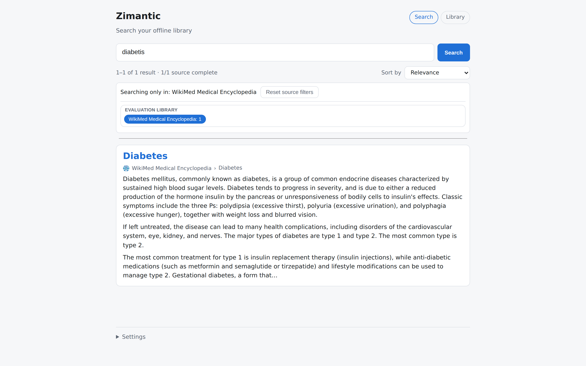
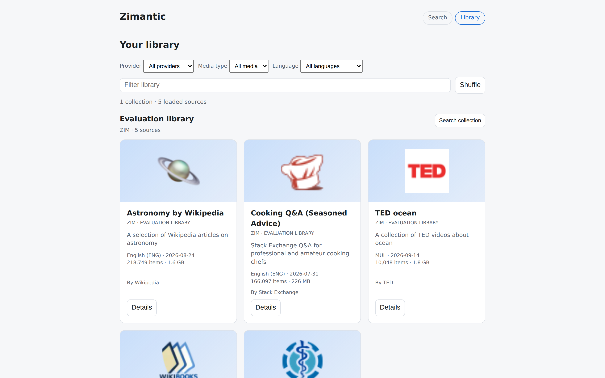

# Zimantic

Zimantic is an offline search engine for Kiwix ZIM files and configured directory trees, such as an offline copy of `/library/www/html/modules`. Semantic search finds articles from questions and descriptions, including misspellings and queries in another language. Zimantic runs offline on devices as small as a Raspberry Pi Zero 2 W.

Semantic search has the best coverage in widely spoken languages. Coverage varies by language; see [Compared with Kiwix search](docs/search.md#compared-with-kiwix-search).

| Query | Kiwix search | Zimantic |
|---|---|---|
| "what causes lockjaw" | *Tetanus* not in the top 20 | *Tetanus* at **#1** |
| "diabetis" (misspelled) | *Diabetes* not in the top 20 | *Diabetes* at **#1** |
| "糖尿病" (Chinese for "diabetes") | *Diabetes* not in the top 20 | *Diabetes* at **#1** |

*Searched in WikiMed, the Wikipedia medical encyclopedia ZIM file.*



*The misspelled query "diabetis" finds Diabetes with no shared words. The search is scoped to WikiMed.*

## Features

- Semantic search matches articles from questions and descriptions when the query and the title share no words.
- Alternate names and misspellings work: "diabetis" finds *Diabetes*, and "Leber's disease" finds *Leber's hereditary optic neuropathy*.
- A multilingual query uses one model. The default covers 50 languages, and the optional e5 models cover more than 100. A query in one language finds articles written in another. Results are strongest in widely used languages; see [Compared with Kiwix search](docs/search.md#compared-with-kiwix-search).
- Collections and sources provide several scopes. Browse the library by collection and provider, search one collection as a unit, or combine individual sources. See [Source selection](docs/usage.md#source-selection).
- A Files collection searches and serves one configured directory tree, such as an offline copy of `/library/www/html/modules`, as one collection with a fixed scope. See [Files collections](docs/collections.md#files-collections).
- Kolibri installations are searched and served directly. Each installed channel is one collection, and each top-level topic is one source. See [Kolibri installations](docs/collections.md#kolibri-installations).
- Combined ranking orders semantic, title, and full-text results in one list. The full-text list combines SQLite body search with ZIM full-text search.
- Merged results collapse redirects into the target article, so each article appears one time. Up to `preview_limit` results per page carry a size-limited preview; the rest keep an empty lead.
- Progressive results run sources in parallel. The page shows a provisional merged list as each source finishes, then reranks the list deterministically.
- The library page at `/library` shows ZIM collections, Files collections, Kolibri channels, and remote Kiwix books, grouped by collection with provider and media-type filters. See [Library view](docs/usage.md#library-view).
- Zimantic uses about 250–325 MB while it serves, which supports devices such as a Raspberry Pi Zero 2 W (512 MB RAM). See [Measured memory use](docs/search.md#measured-memory-use).
- Search without vectors uses the available indexes. Title and body search work when their indexes exist. A ZIM file without a Zimantic index uses its ZIM full-text index. If a model or FAISS file is unavailable, or model probes do not match, Zimantic uses the available lexical search. An invalid ZIM full-text index affects only that ZIM file. The server logs the error and continues. Use [`zimantic diagnose`](docs/usage.md#diagnosing-zim-files) to check suspect files without effect on the server.
- Concurrent searches are limited by `max_concurrent_searches`. A request waits up to `slot_wait_seconds` for a free slot before it reports busy, so overlapping searches queue on slow hardware. An abandoned browser stream skips queued source work and returns its slot. Identical in-flight queries share one computation. An in-memory cache limited by `cache_size` and `cache_bytes` answers repeated queries, including deadline-limited partial pools for `partial_cache_seconds`. Zimantic caches explicit source and collection scopes by their expanded source keys and publication generation. See [Source selection](docs/usage.md#source-selection).
- Built-in article serving opens result links directly from the ZIM files, including redirects, assets, and each ZIM homepage, without `kiwix-serve`.
- The web interface and JSON API serve browsers and custom programs. Routes use short paths such as `/search`, `/suggest`, `/library`, `/collections.json`, `/content/<source-key>/<path>`, `/article/<source-key>/<path>`, and `/health`.

Zimantic searches local ZIM files directly and does not need a separate Kiwix index. `zimantic build` creates semantic vectors and a SQLite title index. `zimantic serve` also searches a ZIM file without an index through its ZIM full-text index. Zimantic serves articles, assets, and homepages directly from each ZIM file. Use [kiwix-serve](https://kiwix.org/en/applications/) only for remote Kiwix sources.

## Requirements

- Python 3.11–3.14 with native dependency wheels for the interpreter. `libzim` publishes wheels for specific Python ABIs and platforms. Select an interpreter with a compatible wheel; the range covers the interpreter versions with published native wheels.
- On 32-bit Linux platforms (armhf/armv7), the native dependencies have no prebuilt wheels. Use the distribution packages. Debian 13 (trixie) or later provides `python3-onnxruntime`, `python3-faiss`, `python3-libzim`, `python3-sentencepiece`, and `python3-pymupdf` for armhf. Create the environment with `--system-site-packages` so Zimantic uses them. All platforms require python-libzim 4.1 or later. Python package markers report the machine name, not the interpreter bitness. A 32-bit interpreter that reports a 64-bit machine name therefore requires a 4.1-or-newer distribution package.
- About 110 MB for the default embedding model, plus the ZIM files. The `multilingual-e5-small` alternative uses about 120 MB, and the English-only `e5-small-v2` model uses about 35 MB on disk.
- Wikipedia-style ZIM files. Zimantic uses their predictable HTML structure to locate useful content blocks.
- One provider interface covers ZIM, remote Kiwix, Files, and Kolibri. Source identity is a stable, URL-safe `key`; `provider` is the only discriminator.
- Configuration declares collections with `[[collections]]` entries for ZIM roots, Kiwix servers, directory trees, and Kolibri installations.
- Local sources do not need `kiwix-serve`. A Kiwix `[[collections]]` entry discovers remote books and opens their results through links from the kiwix-serve search API.

## Install

1. Clone the repository into the data directory. Configuration is at `$XDG_CONFIG_HOME/zimantic/config.toml` (normally `~/.config/zimantic/config.toml`); omitted settings use hardware and XDG defaults.

   ```bash
   data_home="${XDG_DATA_HOME:-$HOME/.local/share}"
   config_home="${XDG_CONFIG_HOME:-$HOME/.config}"
   mkdir -p "$data_home" "$config_home/zimantic"
   git clone https://github.com/OscSanto/zimantic.git "$data_home/zimantic"
   cd "$data_home/zimantic"
   if [ ! -e "$config_home/zimantic/config.toml" ]; then
       cp config.toml "$config_home/zimantic/config.toml"
   fi
   ```

2. Install the CLI with uv. This command installs the locked runtime dependencies without the development tools and creates the executable at `~/.local/bin/zimantic`.

   ```bash
   uv sync --locked --no-dev --no-editable
   ln -sfn "$PWD/.venv/bin/zimantic" ~/.local/bin/zimantic
   ```

   For development, run `uv sync` and activate the environment with `. .venv/bin/activate`.

   On 32-bit armhf, the native dependencies have no wheels. Install the distribution packages and let the environment use them:

   ```bash
   sudo apt install python3-venv python3-numpy python3-tqdm python3-onnxruntime \
       python3-sentencepiece python3-faiss python3-libzim python3-pymupdf \
       python3-fastapi python3-uvicorn
   python3 -m venv --system-site-packages .venv
   .venv/bin/pip install 'puremagic>=1.30' 'tokenizers>=0.23'
   .venv/bin/pip install --no-deps .
   ln -sfn "$PWD/.venv/bin/zimantic" ~/.local/bin/zimantic
   ```

3. Download the default multilingual model.

   ```bash
   zimantic model
   ```

   The command downloads the default static model's int8 export to `$XDG_DATA_HOME/zimantic/model/int8/` together with its WordPiece vocabulary. On a GPU host, use the `multilingual-e5-small` transformer instead: `zimantic model fp16 --model multilingual-e5-small`, then set `model_dir = "model/multilingual-e5-small/fp16"`. Accelerated providers run fp16 faster than int8. The static default gains little from a GPU, and the transformer retrieves better. Copy `config.gpu.toml` for a complete starting point. `zimantic model --list` shows every supported model, and `zimantic model --help` shows the options.

   For a manual install of the quality-first transformer alternative, `multilingual-e5-small`:

   ```bash
   data_home="${XDG_DATA_HOME:-$HOME/.local/share}"
   mkdir -p "$data_home/zimantic/model-e5/int8"
   curl -L -o "$data_home/zimantic/model-e5/int8/model.onnx" https://huggingface.co/Xenova/multilingual-e5-small/resolve/main/onnx/model_quantized.onnx
   curl -L -o "$data_home/zimantic/model-e5/int8/sentencepiece.bpe.model" https://huggingface.co/intfloat/multilingual-e5-small/resolve/main/sentencepiece.bpe.model
   ```

   Then set `model_dir = "model-e5/int8"`. Do not copy the static model files by hand. The model ships its vocabulary only as `tokenizer.json`, and `zimantic model` derives the runtime `vocab.txt` from that file. English-only and larger multilingual models use the same layout; see [Using a different embedding model](docs/search.md#using-a-different-embedding-model). Zimantic reports a file that does not match a documented checksum and continues to run.

4. Put ZIM files in `$XDG_DATA_HOME/zimantic/zims/`. Download them from [library.kiwix.org](https://library.kiwix.org) or [download.kiwix.org/zim](https://download.kiwix.org/zim/).

5. Add a collection and check the XDG config. Zimantic has no implicit library. Uncomment or add the `[[collections]]` ZIM entry from `config.toml`. Use an absolute `path`, because provider paths resolve from the config file's directory. Relative `model_dir` and `index_dir` overrides resolve under `$XDG_DATA_HOME/zimantic`; omit them to use the defaults. Add Kiwix, files, or Kolibri entries only for those sources.

6. Verify the installation.

   ```bash
   zimantic --help
   ```

   For a development runtime check, follow [Development install](CONTRIBUTING.md#development-install) and run `python -m pytest tests/test_runtime_api.py`. Use `python -m pytest` for the full test suite.

### Windows

Zimantic supports 64-bit Windows (x86-64) on Python 3.11–3.14. Windows ARM64 and 32-bit Windows are not supported because `libzim`, `faiss-cpu`, and `onnxruntime` do not publish wheels for those targets.

Use these Windows equivalents:

```powershell
git clone https://github.com/OscSanto/zimantic.git zimantic
cd zimantic
uv sync --locked --no-dev
.venv\Scripts\activate
zimantic --help
```

Download the default model with the CLI:

```powershell
zimantic model
```

On Windows, the default `model_dir` is `./model/int8`. On a GPU host, use `zimantic model fp16 --model multilingual-e5-small` and set `model_dir = "./model/multilingual-e5-small/fp16"` in `config.toml`. The static default ships its vocabulary only as `tokenizer.json`, and the command derives the runtime `vocab.txt`; use the CLI and do not copy those files by hand. For a manual install of the `multilingual-e5-small` alternative:

```powershell
New-Item -ItemType Directory -Force model-e5\int8 | Out-Null
Invoke-WebRequest -Uri https://huggingface.co/Xenova/multilingual-e5-small/resolve/main/onnx/model_quantized.onnx -OutFile model-e5\int8\model.onnx
Invoke-WebRequest -Uri https://huggingface.co/intfloat/multilingual-e5-small/resolve/main/sentencepiece.bpe.model -OutFile model-e5\int8\sentencepiece.bpe.model
```

Then set `model_dir = "./model-e5/int8"`.

`zimantic reload` is unavailable on Windows because it relies on `SIGHUP`. Restart `zimantic serve` to reload. Stop the server before you replace or delete a ZIM file or index file. Windows does not allow an in-place replacement of an open file.

## Optional dependencies

Core search does not require external tools. Local caption extraction, OCR, ASR, and remote Kiwix support are optional; see the [dependency and derived-text guide](docs/derived-text.md#optional-dependencies).

## Configuration and collections

Zimantic uses explicit `[[collections]]` entries for ZIM files, remote Kiwix, directory trees, and Kolibri installations. The [collections guide](docs/collections.md) has minimal examples, path behavior, provider limits, and advanced overrides.



*The library groups sources by collection and filters them by provider, media type, language, or text.*

## Usage

```bash
zimantic build
zimantic serve
zimantic open zims/example.zim
zimantic reload
```

A build with no arguments indexes configured local collections. For command options, build behavior, GPU setup, hardware tuning, and systemd examples, see [Usage and operations](docs/usage.md). The [web interface guide](docs/usage.md#source-selection) covers source selection and the library. The [API reference](docs/api.md) documents the HTTP endpoints.


*Result links open articles, assets, and homepages directly from the ZIM file, without `kiwix-serve`.*

## Security and limitations

See [Limitations](docs/limitations.md) for operational constraints and [Architecture](docs/architecture.md) for provider boundaries and content safety.

## Search details

The search examples illustrate behavior; they are not a universal benchmark. See [Search, models, and ranking](docs/search.md) for model selection, ranking behavior, measured performance, and the detailed Kiwix comparison.
