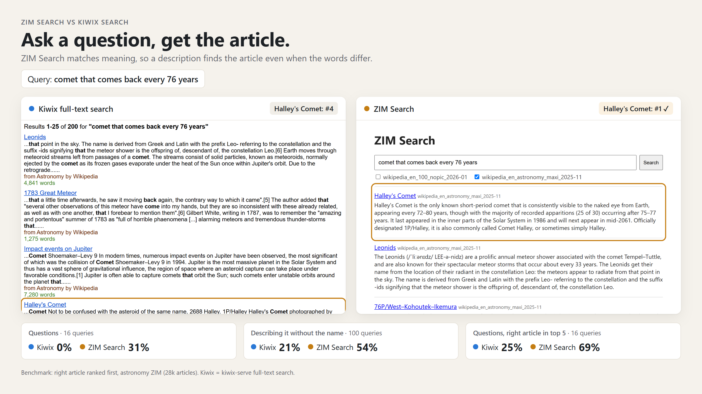
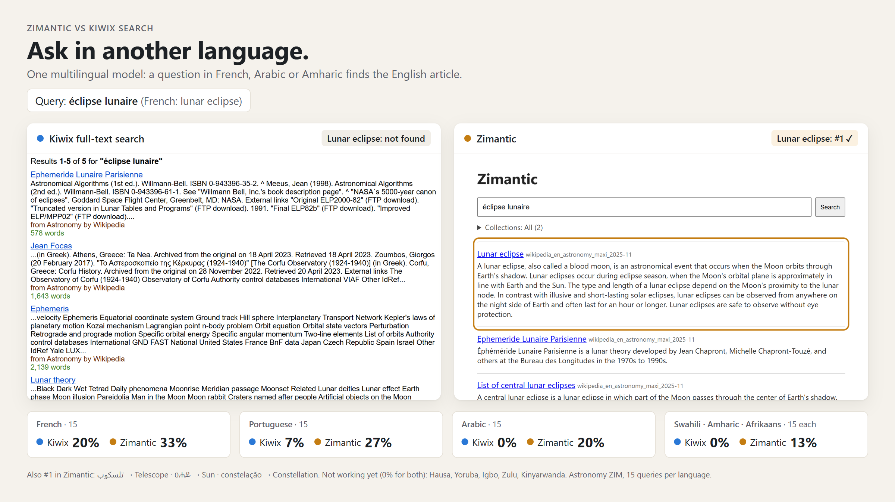
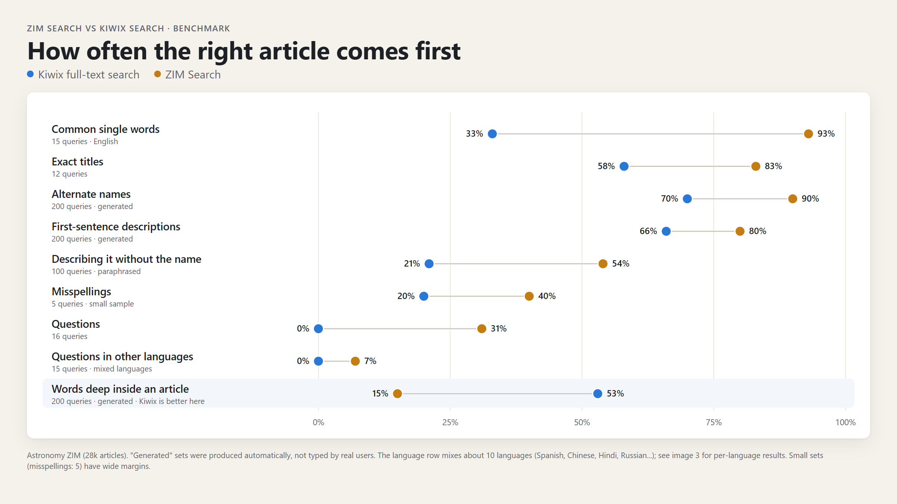

# Zimantic

Zimantic is an offline search engine for Kiwix ZIM files, the compressed offline copies of Wikipedia and other sites published by Kiwix, and for configured directory trees such as an offline `/library/www/html/modules`. It retrieves articles by meaning rather than by exact keyword overlap, so it can answer questions, match a description written without the article's name, tolerate misspellings, and accept a query in a different language from the article. It runs entirely offline, including on hardware as small as a Raspberry Pi Zero 2 W.

Meaning search performs best in widely spoken languages. Coverage varies by language; see [Compared with Kiwix search](#compared-with-kiwix-search).

| Query | Kiwix search | Zimantic |
|---|---|---|
| "what causes lockjaw" | *Tetanus* not in the top 20 | *Tetanus* at **#1** |
| "diabetis" (misspelled) | *Diabetes* not in the top 20 | *Diabetes* at **#1** |
| "糖尿病" (Chinese for "diabetes") | *Diabetes* not in the top 20 | *Diabetes* at **#1** |

*Searched in WikiMed, the Wikipedia medical encyclopedia ZIM.*

## Features

- **Meaning search (semantic search).** Questions and descriptions match articles even when they share no words with the title.
- **Alternate names and misspellings.** "diabetis" finds *Diabetes*; "Leber's disease" finds *Leber's hereditary optic neuropathy*.
- **Multilingual queries.** One model covers 100+ languages, and a query in one language can find articles written in another. Results are strongest in widely used languages; see [Compared with Kiwix search](#compared-with-kiwix-search).
- **Collections and multiple sources.** Browse the library by collection and provider, search one collection as a unit, or combine individual sources. See [Source selection](#source-selection).
- **Files collections.** Search and serve a configured directory tree, such as an offline copy of `/library/www/html/modules`, as one bounded collection. See [Files collections](#files-collections).
- **Kolibri installations.** Search and serve a local Kolibri v0.19.5 installation directly, with one collection per installed channel and one source per top-level topic. See [Kolibri installations](#kolibri-installations).
- **Hybrid ranking.** Meaning, title-word, and full-text retrieval are fused into a single ranking.
- **Merged results and bounded previews.** Redirects are merged into their target article, so each article appears once. Each result carries a bounded excerpt as its preview.
- **Progressive results.** Sources run in parallel. The page shows a provisional merged list as each source finishes, then reranks it deterministically.
- **Library view.** Browse ZIM collections, files collections, Kolibri channels, and remote Kiwix books at `/library`, grouped by collection with provider and content-type filters. See [Library view](#library-view).
- **Low resource use.** Runs on low-resource devices such as a Raspberry Pi Zero 2 W (512 MB RAM) using roughly 250–325 MB while serving; see [Measured memory use](#measured-memory-use).
- **Graceful degradation.** Title-word and full-text search work as soon as an index exists. Vectors are optional, and a ZIM with no index remains searchable through its native full-text index. A missing model, a missing FAISS file, or a different model whose probe embeddings do not match falls back to lexical search instead of failing the server. Native full-text searches run in helper processes, so an archive with an inconsistent full-text index cannot take the server down; only that archive loses native full-text results, and the server logs why.
- **Concurrent searches.** `max_concurrent_searches` bounds simultaneous searches. A request waits up to `slot_wait_seconds` for a free slot before reporting busy, so overlapping searches queue on slow hardware instead of failing immediately; abandoned browser streams skip queued source work and return their slot. Identical in-flight queries share one computation, and repeated queries are answered from an in-memory cache bounded by `cache_size` and `cache_bytes`. Explicit source and collection scopes are cached by their expanded source keys and publication generation; see [Source selection](#source-selection).
- **Built-in article serving.** Result links open directly from the ZIM archives, including redirects, assets, and each ZIM's homepage, without requiring `kiwix-serve`.
- **Web interface and JSON API.** Search from any browser on the network or from custom programs. Routes use short paths such as `/search`, `/suggest`, `/library`, `/collections.json`, `/content/<source-key>/<path>`, `/article/<source-key>/<path>`, and `/health`.

Zimantic queries the local ZIM archives themselves, not a separate Kiwix index. `zimantic build` adds meaning vectors and a SQLite title-word index, but it is not a prerequisite for `zimantic serve`: an unbuilt ZIM is still searched through the archive's own full-text index, and articles, assets, and homepages are served directly from the archive. An optional [kiwix-serve](https://kiwix.org/en/applications/) instance is useful only for sources available through a Kiwix server, which Zimantic can search with kiwix-serve's full-text API.

## Requirements

- Python 3.11–3.14 with native dependency wheels available for the interpreter. `libzim` publishes wheels for specific Python ABIs and platforms, so choose an interpreter with a compatible wheel. Update this range when the native dependencies add support for a newer Python version.
- 32-bit Linux platforms (armhf/armv7) have no prebuilt wheels for the native dependencies. They work when the dependencies are installed as distribution packages. Debian 13 (trixie) or newer provides `python3-onnxruntime`, `python3-faiss`, `python3-libzim`, `python3-sentencepiece`, and `python3-pymupdf` for armhf. Create the environment with `--system-site-packages` so Zimantic can use them.
- About 120 MB for the default embedding model, plus the ZIM files. The English-only `e5-small-v2` model is about 35 MB on disk.
- Wikipedia-style ZIM files. Zimantic relies on their predictable HTML structure to locate useful content blocks.
- **One provider seam.** ZIM, remote Kiwix, files, and Kolibri are in-tree providers. Source identity is a stable, URL-safe `key`; `provider` is the only discriminator.
- **Configured collections.** Collections are declared with `[[collections]]` entries (ZIM roots, Kiwix servers, files trees, and Kolibri installations).
- No `kiwix-serve` is needed for local sources: Zimantic serves local results and articles directly. A Kiwix `[[collections]]` entry discovers remote books and opens their results through links returned by kiwix-serve's search API.

## Install

1. **Clone the repository into the data directory.** Configuration lives at `$XDG_CONFIG_HOME/zimantic/config.toml` (normally `~/.config/zimantic/config.toml`); omitted settings use hardware and XDG defaults.

   ```bash
   data_home="${XDG_DATA_HOME:-$HOME/.local/share}"
   config_home="${XDG_CONFIG_HOME:-$HOME/.config}"
   mkdir -p "$data_home" "$config_home/zimantic"
   git clone https://github.com/OscSanto/zimantic.git "$data_home/zimantic"
   cd "$data_home/zimantic"
   if [ ! -e "$config_home/zimantic/config.toml" ]; then
       cp config.toml "$config_home/zimantic/config.toml"
   fi
   ```

2. **Install the CLI with uv.** This installs the locked runtime dependencies without the development tools and creates the executable at `~/.local/bin/zimantic`.

   ```bash
   uv sync --locked --no-dev --no-editable
   ln -sfn "$PWD/.venv/bin/zimantic" ~/.local/bin/zimantic
   ```

   For development, run `uv sync` and activate the environment with `. .venv/bin/activate`.

   On 32-bit armhf, where the native dependencies have no wheels, install the distribution packages and let the environment use them:

   ```bash
   sudo apt install python3-venv python3-numpy python3-tqdm python3-onnxruntime \
       python3-sentencepiece python3-faiss python3-libzim python3-pymupdf \
       python3-fastapi python3-uvicorn
   python3 -m venv --system-site-packages .venv
   .venv/bin/pip install --no-deps .
   ln -sfn "$PWD/.venv/bin/zimantic" ~/.local/bin/zimantic
   ```

3. **Download the default multilingual model.**

   ```bash
   zimantic model
   ```

   This downloads the int8 export to `$XDG_DATA_HOME/zimantic/model/int8/model.onnx` and its tokenizer vocabulary. On a GPU host, download fp16 instead with `zimantic model fp16`; fp16 is faster on CUDA, ROCm, DirectML, and OpenVINO, while int8 is the smallest CPU-oriented default. In that case set `model_dir = "model/fp16"` in the XDG config. `zimantic model --list` shows the other supported e5 models, and `zimantic model --help` shows the options. The equivalent manual download is:

   ```bash
   data_home="${XDG_DATA_HOME:-$HOME/.local/share}"
   mkdir -p "$data_home/zimantic/model/int8"
   curl -L -o "$data_home/zimantic/model/int8/model.onnx" https://huggingface.co/Xenova/multilingual-e5-small/resolve/main/onnx/model_quantized.onnx
   curl -L -o "$data_home/zimantic/model/int8/sentencepiece.bpe.model" https://huggingface.co/intfloat/multilingual-e5-small/resolve/main/sentencepiece.bpe.model
   ```

   English-only and larger multilingual models use the same layout; see [Using a different embedding model](#using-a-different-embedding-model). Zimantic warns when `model.onnx` or `sentencepiece.bpe.model` differs from a documented checksum, but continues to run.

4. **Put ZIM files in `$XDG_DATA_HOME/zimantic/zims/`.** Download them from [library.kiwix.org](https://library.kiwix.org) or [download.kiwix.org/zim](https://download.kiwix.org/zim/).

5. **Add a collection and check the XDG config.** There is no implicit library, so uncomment or add the `[[collections]]` ZIM entry from `config.toml` (use an absolute `path`, because provider paths resolve from the config file's directory). Relative `model_dir` and `index_dir` overrides resolve under `$XDG_DATA_HOME/zimantic`; omit them to use the defaults. Add Kiwix, files, or Kolibri entries only for those sources.

6. **Verify the installation.**

   ```bash
   zimantic --help
   ```

   For a development runtime check, follow [Development install](CONTRIBUTING.md#development-install) and run `python -m pytest tests/test_runtime_api.py`. Use `python -m pytest` for the full suite.

### Windows

Zimantic supports 64-bit Windows (x86-64) on Python 3.11–3.14. Windows ARM64 and 32-bit Windows are not supported because `libzim`, `faiss-cpu`, and `onnxruntime` do not publish wheels for those targets.

The installation steps work with the Windows equivalents:

```powershell
git clone https://github.com/OscSanto/zimantic.git zimantic
cd zimantic
uv sync --locked --no-dev
.venv\Scripts\activate
zimantic --help
```

Download the default model with the CLI:

```powershell
zimantic model
```

On Windows, the default `model_dir` is `./model/int8`. On a GPU host use `zimantic model fp16` and set `model_dir = "./model/fp16"` in `config.toml`. The PowerShell equivalent of the manual int8 download is:

```powershell
New-Item -ItemType Directory -Force model\int8 | Out-Null
Invoke-WebRequest -Uri https://huggingface.co/Xenova/multilingual-e5-small/resolve/main/onnx/model_quantized.onnx -OutFile model\int8\model.onnx
Invoke-WebRequest -Uri https://huggingface.co/intfloat/multilingual-e5-small/resolve/main/sentencepiece.bpe.model -OutFile model\int8\sentencepiece.bpe.model
```

`zimantic reload` is unavailable on Windows because it relies on `SIGHUP`; restart `zimantic serve` to reload. Stop the server before you replace or delete a ZIM or index file. Windows does not allow an open file to be replaced in place.

## Optional dependencies

Everything in this section is optional. Zimantic starts and searches without
any of it. A missing executable disables only the operation that needs it, and
a build reports that operation as unavailable instead of failing the rest of
the index.

| Dependency | Enables | Without it |
|---|---|---|
| `ffmpeg` and `ffprobe` | Embedded text-caption extraction and audio decoding for `whisper.cpp` | Sidecar `.srt`/`.vtt` captions still work; embedded tracks and whisper.cpp ASR are unavailable |
| `tesseract` plus trained language data | `ocr = "tesseract"` on images and image-only PDF pages | OCR is unavailable |
| `whisper-cli` from [whisper.cpp](https://github.com/ggml-org/whisper.cpp) | `asr = "whisper"` with `asr_engine = "whisper.cpp"` or `"auto"` | That backend is unavailable; `auto` falls through to another installed engine |
| `whisper-ctranslate2` from [faster-whisper](https://github.com/SYSTRAN/faster-whisper) | `asr = "whisper"` with `asr_engine = "faster-whisper"` | That backend is unavailable; it is the fastest option on CUDA GPUs |
| `lsar` (from `unar`) | Archive-container detection for files with a missing or unknown extension | Built-in signatures and `puremagic` are still used |
| `kiwix-serve` | A remote `type = "kiwix"` collection | Remote Kiwix sources are unavailable; local ZIM, files, and Kolibri sources still work |
| GPU ONNX Runtime wheel | Accelerated embedding during `build` and `serve` | Zimantic warns and embeds on the CPU; see [GPU acceleration](#gpu-acceleration) |

On Debian or Ubuntu:

```bash
sudo apt install ffmpeg tesseract-ocr tesseract-ocr-eng unar
```

The OCR language package names follow the codes accepted by `ocr_languages`.
Install every language you list there, for example `tesseract-ocr-ita` for
`["eng", "ita"]`; `tesseract-ocr-all` installs every language.
`tesseract --list-langs` shows what is installed.

On macOS with Homebrew:

```bash
brew install ffmpeg tesseract tesseract-lang unar
```

On Windows, install ffmpeg and Tesseract from their official builds and put
`ffmpeg.exe`, `ffprobe.exe`, and `tesseract.exe` on `PATH`. `lsar` is optional
on every platform.

### Quick start: remote Kiwix

Install `kiwix-serve` from [kiwix.org](https://kiwix.org/en/applications/) and
start it with a library XML file:

```bash
kiwix-serve --port=8085 /path/to/library.xml
```

Then point a `type = "kiwix"` collection at it:

```toml
[[collections]]
type = "kiwix"
name = "remote"
server = "http://127.0.0.1:8085"
catalog_limit = 1000
max_catalog_entries = 50000
```

Local ZIM, files, and Kolibri sources never use `kiwix-serve`.

GPU ONNX Runtime wheels are covered in
[GPU acceleration](#gpu-acceleration).

### Whisper ASR models

`asr = "whisper"` uses a local Whisper engine. Two backends are supported:

| `asr_engine` | Executable | Best for |
|---|---|---|
| `whisper.cpp` | `whisper-cli` | CPU-only and low-memory devices, including a Raspberry Pi |
| `faster-whisper` | `whisper-ctranslate2` | CUDA GPUs; up to 4× faster than the openai-whisper backend, or up to 16× with batched inference |
| `auto` | first available | Prefers whisper.cpp, then faster-whisper |

#### Quick start: whisper.cpp (CPU and edge devices)

```bash
git clone https://github.com/ggml-org/whisper.cpp
cmake -B whisper.cpp/build -S whisper.cpp
cmake --build whisper.cpp/build -j --config Release
sudo install whisper.cpp/build/bin/whisper-cli /usr/local/bin/
sudo apt install ffmpeg   # Debian/Ubuntu; whisper.cpp needs ffmpeg
```

```toml
[derived_text]
asr_engine = "whisper.cpp"
asr_model = "tiny.en-q5_1"   # ~31 MiB; good default for a Pi Zero 2 W
# asr_model = "tiny-q5_1"    # Spanish / multilingual
asr_threads = 2              # use 4-8 on a Pi 5 or desktop CPU
```

Use `base.en-q5_1` (~57 MiB) when accuracy matters more than size.
For Spanish or other languages, use the multilingual `base-q5_1` checkpoint.

#### Quick start: faster-whisper (NVIDIA GPU)

```bash
pipx install whisper-ctranslate2
# GPU execution also needs CUDA 12 cuBLAS and cuDNN 9.
```

```toml
[derived_text]
asr_engine = "faster-whisper"
asr_model = "base.en"   # or large-v3 / distil-large-v3 for higher accuracy
# asr_model = "base"    # for Spanish / multilingual
asr_batched = true      # extra 2-4x throughput on GPU
```

faster-whisper has no official CLI, so Zimantic uses `whisper-ctranslate2`,
its openai-whisper-compatible client. It is the fastest backend on CUDA GPUs
and does not need a system ffmpeg.

Use `pipx` for faster-whisper, or reinstall it with `uv pip` after a `uv sync`,
because `uv sync` prunes packages that are not in the lockfile.

Select the backend and model under `[derived_text]`:

```toml
[derived_text]
asr_engine = "auto"   # auto, whisper.cpp, faster-whisper
asr_model = "base.en"
# asr_model = "base"  # Spanish / multilingual
asr_threads = 0       # 0 uses the engine default
asr_batched = false   # faster-whisper: extra 2-4x speed, uses VAD
```

`auto` prefers whisper.cpp because it is the lightest and most portable. On a
CUDA host, set `asr_engine = "faster-whisper"` explicitly to get the GPU
speedup, and set `asr_batched = true` for its additional throughput. In a mixed
install, the same `asr_model` name works across backends:
for example `base.en` maps to `ggml-base.en.bin` or the faster-whisper
`Systran/faster-whisper-base.en` repository. For Spanish or other languages,
use `base`, which maps to `ggml-base.bin` or
`Systran/faster-whisper-base`.

For whisper.cpp, quantized models are supported by name:

```toml
asr_model = "tiny.en-q5_1"   # about 31 MiB; smaller and faster than tiny.en
# asr_model = "tiny-q5_1"    # Spanish / multilingual
```

Approximate non-quantized sizes are 75 MB (`tiny`), 142 MB (`base`), 466 MB
(`small`), 1.5 GB (`medium`), and 2.9 GB (`large`). faster-whisper also accepts
distilled models such as `distil-large-v3`, `distil-medium.en`, and
`distil-small.en`.

Zimantic downloads the selected checkpoint on first use when it is missing.
Downloads are atomic, checksum-verified, and serialized by a per-model lock, so
concurrent builds fetch one copy and reuse it. Each backend keeps its models in
the usual place:

| Backend | Cache |
|---|---|
| whisper.cpp | `$XDG_CACHE_HOME/zimantic/whisper-cpp` or `~/.cache/zimantic/whisper-cpp` |
| faster-whisper | `$XDG_CACHE_HOME/zimantic/faster-whisper` or `~/.cache/zimantic/faster-whisper` |

The host needs network access the first time a model is fetched. If it is
offline or the download fails, only ASR is marked partial and the build exits
non-zero; a cached model is reused without a network request. To prepare a
machine in advance, copy the backend's cache directory from another host or run
a build that enables ASR while online.

### Quick start: Tesseract OCR

```bash
sudo apt install tesseract-ocr tesseract-ocr-fra
# add tesseract-ocr-<lang> for every language you list
```

```toml
[[collections]]
type = "files"
name = "media"
path = "./media"
derived_text = { ocr = "tesseract", ocr_languages = ["fra"] }
```

OCR reads the same trained-data files as the `tesseract` command. List the
languages globally or override them for a collection or exact source. Use the
installed trained-data names: French is normally `fra`, not `fre`. Codes pass
through unchanged; Zimantic does not translate aliases or install language data.
For the example above, install `tesseract-ocr-fra`. Collection defaults are
supported for files and Kolibri collections; ZIM embedded-media enrichment is
not implemented.

```toml
[derived_text]
ocr_languages = ["eng"]   # codes from `tesseract --list-langs`
```

PDF OCR uses the bundled PyMuPDF dependency; only the `tesseract` executable
and its language data are external. The `max_ocr_pages`, `max_ocr_pixels`, and
`max_ocr_output_bytes` caps still apply.

## Files and directories

The installed CLI is separate from configuration and runtime data. On XDG platforms, configuration is read from `$XDG_CONFIG_HOME/zimantic/config.toml` (normally `~/.config/zimantic/config.toml`); ZIMs, models, and indexes default under `$XDG_DATA_HOME/zimantic` (normally `~/.local/share/zimantic`). If the XDG config is missing, Zimantic uses profile defaults; it does not search the current directory. Relative global path overrides (`model_dir`, `index_dir`) resolve under the data directory. Relative provider `path`/`database_path`/`storage` values resolve against the directory containing the active config file, even through a symlink. On Windows, the default config remains `config.toml` in the current directory.

```
~/.local/share/zimantic/
├── model/               ← downloaded models; model/int8/ is model_dir         (you download)
├── zims/                ← ZIM collection path: your .zim files                (you download)
├── indexes/             ← index_dir: immutable generations under provider/collection/source
└── catalog.sqlite       ← shared ZIM metadata cache (metadata only, no vectors)
```

```
~/.config/zimantic/config.toml          ← optional settings
$XDG_RUNTIME_DIR/zimantic/zimantic.pid ← PID file while serving
```

If the files are on a USB drive or another disk, point a ZIM collection's `path`, `model_dir`, or `index_dir` in the XDG config at them.

## Sources and providers

Zimantic has one configuration schema for every in-tree provider. A
`[[collections]]` entry is one collection; the provider discovers one or more
sources inside it (one ZIM archive per source, one files subtree or child group,
one Kolibri channel/topic, one Kiwix book). Every collection is explicit: there
is no `zim_dir`/`kiwix_server` shorthand and no implicit default library.

```toml
[[collections]]
type = "zim"
name = "library"
path = "./zims"
label = "ZIM files"

[[collections]]
type = "files"
name = "modules"
path = "/library/www/html/modules"
label = "Modules"
granularity = "collection"       # or "children"

[[collections]]
type = "kolibri"
name = "kolibri"
path = "/library/kolibri"
label = "Kolibri"
granularity = "children"

[[collections]]
type = "kiwix"
name = "remote"
server = "http://localhost:8085"
label = "Remote Kiwix"
catalog_limit = 1000
max_catalog_entries = 50000
```

Provider `path` values, including `database_path` and `storage`, resolve once
against the directory holding the active config file, even through a symlink.
CLI path operands resolve against the working directory. The resolved choice is
kept when an ad-hoc ZIM build saves a collection entry, so it still points at the
same files on the next invocation. Do not put global scalar keys after a table
header; after `[[collections]]` or `[derived_text]` a key belongs to that table.

Provider limits default in the provider and can be overridden per entry
(`max_sources`, `max_entries`, `max_file_bytes`, `max_visited_entries`,
`traversal_timeout_seconds`, Kiwix `catalog_limit`/`max_catalog_entries`, and the
Kolibri snapshot/HTML5 zip limits). `max_sources` and `max_entries` bound
discovery and indexing, not serving: a permitted file remains browsable even
when indexing was capped. Exceeding `max_sources` collapses a files/Kolibri
collection to one source with a distinct key and a warning; exceeding
`max_entries` marks the source truncated. Rebuild the index when the source
collapses or returns to its normal state.

Global bounds stay global: `max_explicit_collection_sources` (default 500)
limits work for an explicitly selected Kiwix collection and reports partial
scope instead of claiming completion; `search_timeout_seconds` (default 30) is
the admitted-search deadline across providers and is separate from
`source_timeout` and `slot_wait_seconds`; `max_body_text_bytes` (default 1 MiB)
caps the lexical body per item independently of previews and item-count
truncation; `max_derived_cache_bytes_per_source` caps optional preview artifacts
only, never search postings.

Every local indexed provider uses the same immutable generation layout:

```
index_dir/<provider>/<collection>-<digest>/<source>-<digest>/
├── current                         ← JSON manifest pinning one generation
└── generations/<uuid>/
    ├── index.sqlite                ← docs, title/body FTS, metadata
    ├── index.faiss                 ← only when semantic vectors exist
    └── lease                       ← shared reader pin
```

SQLite must be 3.37 or newer for the STRICT catalog and index schemas, and the
SQLite build must provide FTS5; Zimantic checks the version early instead of
deferring a failure to the first query. A sufficiently new SQLite build can
still be compiled without FTS5. `catalog.sqlite` beside `index_dir` is the
private ZIM archive metadata cache.
Files and Kolibri do not write it, and Kiwix has no persistent local catalog. A
catalog with an unsupported schema is discarded and rebuilt by a full ZIM scan.
Use one schema version for a catalog at a time. Index
identity is logical (`provider`, `collection key`, `source key`), never an
absolute source path. Removing or renaming a collection does not delete its
indexes; `zimantic prune` is the explicit cleanup path.

Treat untrusted file trees as untrusted input. Path confinement and traversal
limits apply to serving and indexing, but `secure_browsing` sandboxes only the
`/content/` shell; a raw `/article/` document opened directly or in a permitted
popup is not sandboxed and can run with the app's origin and persistent storage.

### Scoped settings

Extraction limits, search tuning, cache quotas, and Files indexing filters share
one **global → collection → exact-source** resolver. Global defaults stay at the
TOML root; put the same keys directly on a collection or in its `sources`
entries. Only specified fields override inherited values.

| Settings | Scope and effect |
| --- | --- |
| `max_entry_bytes`, `max_html_bytes`, `max_body_text_bytes`, `max_preview_chars`, `max_entries` | Per-source local extraction/indexing budgets; preview settings also apply during search |
| `candidate_count`, `nprobe`, `min_cosine_similarity`, `source_timeout` | Per-source search effort, IVF probes, hybrid semantic threshold, and deadline |
| `cache_size`, `cache_bytes` | Per-source quotas inside the shared query and preview caches; global values also bound each entire cache |
| `max_derived_cache_bytes_per_source` | Per-source derived-preview artifact budget |
| `index_include`, `index_exclude` | Files-only indexing globs; lists replace inherited lists, never change serving permissions |

```toml
max_body_text_bytes = 1_048_576
candidate_count = 16
cache_size = 256
cache_bytes = 33_554_432

[[collections]]
type = "files"
name = "media"
path = "./media"
max_body_text_bytes = 262_144
source_timeout = 3.5
index_exclude = ["**/drafts/**"]
sources = [
  { key = "files:media:root", max_body_text_bytes = 65_536, candidate_count = 8, cache_size = 32 },
]
```

Use exact keys from `/sources`. Extraction/search budgets must be positive;
`min_cosine_similarity` must be between -1 and 1. Cache quotas accept zero:
`cache_size = 0` disables admission for that source, `cache_bytes = 0` means
count-only caching, and `max_derived_cache_bytes_per_source = 0` disables new
derived-preview artifacts without removing searchable text. A mixed-source
query-cache entry counts in full against each participating source's quota.
Raising a scoped quota cannot raise the shared cache's global ceiling.

`index_include` selects permitted primary Files items for indexing, including
media title rows. An empty list restores the normal collection `include`
selection for native documents. `index_exclude` adds indexing-only exclusions;
the existing collection `exclude`, hidden-path, symlink, and confinement rules
always remain in force for both indexing and serving.

Build-affecting settings enter source fingerprints; search/preview policy enters
cache keys. Host-wide model selection, worker pools, memory/concurrency controls,
serving limits, and the overall `search_timeout_seconds` stay global. A source
deadline cannot extend the overall deadline; native calls that cannot be
interrupted are checked when they return.

### Derived text

Derived text has three independent opt-ins, all off by default. Files and
Kolibri collections can set defaults inline on the collection:

```toml
[[collections]]
type = "files"
name = "media"
path = "./media"
derived_text = { captions = "index", ocr = "tesseract", asr = "whisper" }
```

Accepted operation values are:

| Setting | Values | Effect |
| --- | --- | --- |
| `captions` | `"off"`, `"index"` | Index sidecar and available embedded captions |
| `ocr` | `"off"`, `"tesseract"` | OCR images and image-only PDF pages |
| `asr` | `"off"`, `"whisper"` | Transcribe audio/video locally |

`asr_engine` separately selects the Whisper backend: `"auto"`,
`"whisper.cpp"`, or `"faster-whisper"`.

All options accepted under global `[derived_text]` (languages, ASR backend/model,
caps, timeout, workers, and cache) can also appear in a collection's
`derived_text` table or an exact-source override. Precedence is built-in defaults
→ global `[derived_text]` → collection `derived_text` → exact source. Only
specified fields override inherited values; language lists replace rather than
append. Engine options alone never enable an operation.

**Advanced: per-source overrides.** Use `sources` only when a source needs
different operations or engine options from its collection defaults. Each entry
overrides only the fields it specifies:

```toml
[derived_text]
ocr_languages = ["eng"]
asr_model = "base"

[[collections]]
type = "files"
name = "media"
path = "./media"
derived_text = { captions = "index", ocr = "tesseract", ocr_languages = ["fra"], asr = "whisper" }
sources = [
  { key = "files:media:french", asr_model = "small" },
  { key = "files:media:german", ocr_languages = ["deu"], asr = "off" },
]
```

Use keys from `/sources`; the example keys are illustrative. Effective options
participate in source build fingerprints and derived-output cache keys, so
changing them rebuilds affected sources and does not reuse incompatible text.

Setting one does not enable the others. Engines run locally at build time only
and are never loaded by `serve`; a missing engine marks only that operation
unavailable. Zimantic uses local `tesseract`, `whisper-cli`,
`whisper-ctranslate2`, `whisper`, and `ffmpeg`/`ffprobe` executables when they
are on `PATH`; no hosted transcription service is used. ASR uses the backend
selected by `asr_engine` and downloads its checkpoint on first use when it is
absent. See [Optional dependencies](#optional-dependencies) for installing the
backends and their model caches.
Embedded text captions use the optional local `ffmpeg`/`ffprobe`
pair when available, including supported descriptor-only inputs; a missing
pair leaves only embedded-track caption extraction unavailable. The
per-container input and spool caps under
`[derived_text]` are separate from `max_entry_bytes` and may need raising for
large media. See [Files collections](#files-collections) and
[Kolibri installations](#kolibri-installations) for copy-pasteable IIAB layouts
(`/library/www/html/modules` and `/library/kolibri`).

### Files collections

A `type = "files"` collection searches and serves an ordinary directory tree, such as an offline copy of `/library/www/html/modules`. One configured directory is one collection. The default granularity keeps the whole tree as a single source, so a directory of thousands of pages does not become a wall of library cards:

```toml
[[collections]]
type = "files"
name = "modules"
path = "/library/www/html/modules"
label = "Modules"
granularity = "collection"       # "collection" or "children"
include = ["**/*.html", "**/*.htm", "**/*.xhtml",
           "**/*.txt", "**/*.md", "**/*.pdf"]
exclude = ["**/node_modules/**", "**/.git/**", "**/__pycache__/**"]
max_sources = 64
max_entries = 100000
max_file_bytes = 268435456
```

`granularity = "children"` makes each immediate child directory its own source, plus one source for loose files directly in the root. Use it when the tree has a handful of stable top-level units; otherwise keep `collection` so the library stays bounded. If the number of child sources exceeds `max_sources`, the whole collection collapses to one source with a distinct key and a warning. The collapsed and normal states use different source keys. Rebuild the index and update any `sources` override that uses the other key.

`max_entries` bounds the indexed manifest and marks the source truncated when more candidates exist; all permitted files remain servable. `max_file_bytes` is combined with the global `max_entry_bytes` to bound document extraction, and `max_sources` bounds the child-source list.

Source keys use the configured `name` and root-relative identifiers, never the absolute path. The collection key is `files:<name>`; collection granularity uses `files:<name>:root`, a collapsed collection uses `files:<name>:collapsed`, a child uses `files:<name>:dir-<slug>-<digest>`, and loose root files use the reserved `files:<name>:__loose__`. The configured name is part of the key, so a different name has a different identity and index.

All sources in one files collection share the collection-relative serving namespace. A child page can link to `../shared/style.css` and it resolves under the same source key; search results and library membership still belong to the source that indexed the item. Hidden paths, configured excludes, symlinks, and paths outside the configured root are never served. Unknown extensions are served as attachments with `X-Content-Type-Options: nosniff`; SVG opened directly is sandboxed with a restrictive CSP.

`include` selects native documents for indexing by default. Scoped `index_include` and `index_exclude` can change indexing selection without changing serving permissions. Permitted image, audio, and video files are title-searchable by filename without reading their bytes. Captions, OCR, and ASR stay off unless enabled by the collection's `derived_text` defaults (see [Derived text](#derived-text)). Files whose extension is missing or unknown get a bounded MIME probe: the built-in signatures and `puremagic` are used for the prefix, and `lsar` identifies archive containers. This keeps extensionless media and servable “other” assets visible in the library content-type filters.

`zimantic build` with no positional paths builds configured files collections as well as ZIM collections, using the same index generations, embeddings, and lock as ZIM builds. Serving does not require an index: permitted files remain browsable even when indexing was capped or skipped.

With `secure_browsing = true`, the `/content/` shell sandboxes the article iframe. A raw `/article/` page opened directly or in a permitted popup is not sandboxed; treat untrusted file trees as untrusted input regardless of that setting.

### Kolibri installations

A `type = "kolibri"` collection reads a local Kolibri installation directly; Kolibri does not need to be running. The supported target is **Kolibri v0.19.5** with its installed SQLite schema. Older releases and other layouts are reported as unsupported rather than guessed from a channel export database. An IIAB-style installation looks like this:

```toml
[[collections]]
type = "kolibri"
name = "kolibri"
path = "/library/kolibri"          # home containing db.sqlite3 and content/storage
label = "Kolibri"
granularity = "children"           # "children" (top-level topics) or "collection"
max_sources = 64
max_entries = 500000
# Private consistent snapshots; all limits must be positive. The disk budget
# must be at least the per-snapshot limit.
max_snapshot_bytes = 1073741824
snapshot_disk_budget_bytes = 3221225472
snapshot_timeout_seconds = 10
# Bounded HTML5 zip serving.
max_html5_zip_entries = 10000
max_html5_zip_directory_bytes = 8388608
max_html5_zip_member_bytes = 268435456
max_html5_zip_total_bytes = 1073741824
html5_zip_timeout_seconds = 10
```

Each installed channel is one collection (`kolibri:<name>:<channel_id>`). With `granularity = "children"`, each top-level topic becomes a source, direct leaf items under the channel root form an `Ungrouped` source, and a channel with no topics gets one whole-channel source. `granularity = "collection"` always uses one source per channel. If the topic count exceeds `max_sources`, the whole channel collapses to one source with the distinct `:collapsed` key and a warning; `max_entries` bounds the indexed manifest and marks the source truncated while all permitted items remain servable. Source keys are `kolibri:<name>:<channel_id>:node:<node_id>`, `:ungrouped`, `:root`, or `:collapsed`.

Items are leaf content nodes with locally available files, plus exercises whose public description is non-empty. Topics are grouping only. Titles, public descriptions, HTML/PDF/plain documents, and an HTML5 app's entry page are indexed. Audio and video bodies contribute no text unless enabled by the collection's `derived_text` defaults (see [Derived text](#derived-text)).

Discover the exact key first (for example from `/sources`). Captions can use
existing `.vtt`/`.srt` tracks and embedded text tracks; ASR transcribes
audio/video when captions did not provide usable text.

The provider **never writes to Kolibri**. It copies the installed database through a private, owner-only, SQLite-consistent snapshot outside the installation and storage roots; committed WAL data is included, and a concurrently changing source causes a bounded retry or a fail-closed diagnostic instead of a torn read. Snapshots are shared across a channel discovery batch, removed after their last reader, and capped by the configured size, disk, and time budgets. A failed refresh keeps the last complete published batch and reports the error. The installation database and its WAL/SHM/journal sidecars are not modified, migrated, vacuumed, or checkpointed.

Keep the installation, storage, and private snapshot directory on local filesystems. The snapshot copy is validated before and after reading, but a stalled kernel or filesystem cannot provide a hard real-time bound. Content fingerprints use selected database rows and storage-file size/mtime signatures. These identify many content updates but do not prove that the bytes are identical. A same-size write that restores the timestamp can evade detection. Keep installed content immutable or use an external snapshot when strong consistency is required.

Set `database_path` and `storage` only when the active database or content directory is non-standard. The provider reads SQLite installations only: if `options.ini` declares PostgreSQL, the collection is unsupported. Zimantic does not read a separate SQLite file in that installation. Absolute configured paths stay private runtime locators and never appear in source keys, API payloads, or normal logs. `zimantic build` with no positional paths builds configured Kolibri channels along with ZIM and files collections. HTML5 serving supports the `html5_zip` preset (entry `index.html` at the zip root) with bounded streaming, path confinement, duplicate/symlink rejection, and zip-bomb limits; other viewer-dependent presets such as H5P or IMSCP are reported explicitly as unsupported. As with files collections, the browser can still be asked by untrusted app HTML to contact external URLs.

### Copying finished indexes to another machine

Embeddings live only in `index.faiss`. Its row IDs refer to `docs.rowid` in the matching `index.sqlite`, which holds titles, paths, the title and body full-text indexes, derived-text cache references, and build metadata. Copy the pair plus the source's `current` manifest; a `.faiss` copied without its `.sqlite` is unusable, and a `.sqlite` copied without its `.faiss` provides title and body lexical search only. A full index whose `.faiss` is missing still serves lexical results, but a later full build requires `--force` to replace it.

Copying a subset is safe: each source generation is independent. Keep the same canonical source key and the same ZIM bytes on the target, and copy the generation plus its `current` manifest. A ZIM in another collection subfolder has a different key and needs a rebuild. New content at the same relative path invalidates the index. The target must use the same embedding model, or an export whose probe embeddings match it (for example FP32 and int8 exports of the same encoder); otherwise `serve` ignores those vectors and falls back to title and full-text search. The target does not need the GPU used to build them: vector search runs on the CPU.

To copy two completed source generations:

```bash
for source in \
  indexes/zim/library-*/*/current \
  indexes/zim/library-*/*/generations/*; do
    printf '%s\n' "${source#indexes/}"
done > /tmp/index-generations.txt

rsync -a --files-from=/tmp/index-generations.txt indexes/ pi@rpi:~/.local/share/zimantic/indexes/
```

`rsync -a` copies only files whose size or mtime differs. Do not copy `staging-*.sqlite`, `*.tmp`, `*.sqlite-wal`, or `*.sqlite-shm`; staging files are unfinished builds, not published generations. Copy a complete generation directory and then its `current` manifest so a reload never opens a half-written pair. Run `zimantic reload` afterwards.

`catalog.sqlite` is optional for the copy. It contains metadata and icons, never vectors, and a missing catalog is rebuilt by scanning the ZIMs. Its `path` column stores absolute locators, so copying it avoids a scan only when the target resolves a collection to the same absolute paths; otherwise those rows are not reused and the ZIMs are rescanned. The scan opens each ZIM once for metadata, illustration, and counts, not article bodies. A catalog with a different schema is discarded and rebuilt under the cross-process catalog lease. Both `build` and `serve` can create it.

## Usage

### Commands

```bash
zimantic build                        # index every configured ZIM collection
zimantic -v build                     # show info-level logging
zimantic build -vv                    # show debug-level logging
zimantic build zims/x.zim             # index one file
zimantic build zims/a.zim zims/b.zim  # several files
zimantic build --workers 4            # build up to four independent ZIMs at once
zimantic build /media/usb             # every .zim in a folder
zimantic build zims/a.zim /media/usb  # mix files and folders
zimantic build --fast                 # quick title-word + full-text index (no vectors)
zimantic build --wait-stable          # wait for changing download sizes, then index
zimantic build --no-wait-lock         # exit 75 if another build holds the lock
zimantic build --lock-timeout 600     # wait at most ten minutes for the lock
zimantic build --force zims/x.zim     # rebuild one already-indexed ZIM
zimantic build --device cuda          # embed with a CUDA GPU (see below)
zimantic build --provider files       # only files collections
zimantic build --collection modules   # one collection key or entry name
zimantic build --source files:modules:root  # one exact source key
zimantic build --list                 # read-only preview; write nothing
zimantic sources                      # human-readable collections/sources tree
zimantic sources --json               # machine-readable, no absolute paths
zimantic prune --dry-run              # report orphaned Zimantic indexes
zimantic prune --yes                  # delete only those under the build lock
zimantic serve                        # web page; unindexed ZIMs use native full-text search
zimantic serve --fast                 # start without a model or vectors
zimantic serve --device cuda          # keep a CUDA GPU for query embedding
zimantic serve --debug                # include ranking scores and explanations; restart on SIGHUP
zimantic serve --dev                  # alias for --debug
zimantic open zims/a.zim              # throwaway read-only server for one named ZIM
zimantic open zims/                   # every .zim in a folder (recursively)
zimantic open a.zim b.zim             # switch between the selected ZIMs in the toolbar
zimantic open a.zim --no-browser      # print the URL without launching a browser
zimantic open a.zim --port 9000       # pin a loopback port; default is OS-assigned
zimantic reload                       # ask a running server to rescan indexes and ZIMs
zimantic model                        # download the int8 export (CPU default)
zimantic model fp16                   # download fp16; recommended with a GPU
zimantic model fp32 fp16              # download selected precisions
zimantic model --model e5-small-v2    # download another supported e5 model
zimantic model --dir ./models         # write models/<precision>/ instead of model/
zimantic model --list                 # show supported models and precisions
```

`build` accepts files or folders. A folder means every `*.zim` file under it, and with no arguments it builds every configured ZIM, files, and Kolibri collection; Kiwix collections are reported as skipped because they are remote/search-only. Positional paths and `--provider`/`--collection`/`--source` selectors are separate modes and cannot be combined. Selector values are repeatable: values within one selector are ORed, and different selector types are intersected. `--collection` accepts an exact collection key or a configured entry name; a Kolibri entry name selects all of its channels.

An unmatched positional path is atomically appended as a `[[collections]]` ZIM entry so `serve` can discover it. The entry uses a relative path from the active config directory (or an absolute private locator) and a safe unique name. A matched configured ZIM root supplies defaults only: the build still covers exactly the files or folders named on the command line. Restart a running server to load edited configuration; `zimantic reload` rescans startup-configured providers but does not reread configuration. `build --list` previews configured or generated entries and never writes configuration or starts a build. Existing complete generations are skipped. Pass `--force` to rebuild selected indexes, or let a source fingerprint mismatch trigger a rebuild.

`zimantic sources` uses the discovery process from `serve`. It does not start the web server, load the model or FAISS, or modify the catalog, indexes, caches, PID/build/lease files, or configuration. Its `--json` document has `collections` and `sources` at the top level and uses the HTTP record schemas. It omits private locators and absolute paths. `zimantic prune --dry-run` provides the same read-only inventory.

`zimantic prune --yes` holds the build lock and target-based config lock. It rereads configuration and discovery, then deletes only indexes with a valid Zimantic-owned manifest whose collection namespace is not configured. It retains or reports missing or malformed configuration, entries with unknown scope, unavailable discovery, stale `.tmp`/`.upgrade` files, and unrecognized indexes. It never deletes files by filename alone. Manual configuration edits must not race with `prune`. Restart running servers after you edit collection roots and before you build or prune. A stale server can still refer to a removed or different entry. Leases protect open generations, but not indexes the server has not opened. An ad-hoc collection append is safe while a server runs because its scoped catalog refresh does not remove that collection.

`zimantic reload` sends SIGHUP and reports that the signal was delivered, not that the background refresh has finished. A normal server rescans every provider configured at startup (ZIM, files, Kolibri, and Kiwix), but does not reread configuration. Restart the server to load edited settings. A second signal during a refresh is ignored. A `serve --debug` process restarts and rereads configuration on SIGHUP. On platforms without SIGHUP, restart the server to load settings.

Logging defaults to warnings, except that `serve`, `open`, and `model` use info when stderr is a terminal. Repeat `--verbose`/`-v` for info and debug output.

### Opening named ZIMs

`zimantic open` is an inspection command for a named set of archives, not a replacement for `zimantic serve`:

```bash
zimantic open zims/phet_en_all_2026-08.zim
zimantic open zims/a.zim zims/b.zim
zimantic open zims/ --max-sources 32
```

It starts a temporary server on `127.0.0.1` and opens the first selected ZIM. The port is assigned by the operating system unless `--port` pins one. Only the ZIM files named on the command line (after folder expansion) are visible to `/sources`, `/library.json`, search, suggestions, random articles, and the browser; configured collections are not scanned and Kiwix catalogs are ignored. Use `--no-browser` on a headless machine or when the desktop browser cannot be launched.

The scope is read-only and process-scoped. `open` never builds, resumes, publishes, or prunes an index; it never writes `catalog.sqlite`, an index, `zimantic.pid`, a build lock, or config. It may read the persistent catalog once to identify a selected archive, then opens any matching finished index read-only. A uniquely matched catalogued archive keeps its normal source key and `/content/<key>/` URL, so links match a `serve` process using the same catalog. An unmatched, ambiguous, or unreadable archive gets an ephemeral `zim:open:<name>-<position>` key that never locates a persistent index. If a finished index is missing, stale, or mismatched, the archive's native full-text index is used; a ZIM with neither remains readable and navigable but is not searchable.

When more than one ZIM is selected, the article toolbar shows separate previous/next ZIM arrows. They open the adjacent archive's homepage in command-line order and wrap at both ends. These arrows are independent of the search-result and parent-page arrows. They also appear in error shells. `--fast` disables the model and FAISS for this process, just like `serve --fast`; without it, title and full-text search work immediately while semantic search may become available when the model is ready.

`zimantic serve` continues to use the persistent catalog, configured collections, PID file, and SIGHUP reload behavior. Stop the `open` process with Ctrl-C or SIGTERM; it closes its indexes and removes nothing from the user's library.

### Build behavior and locking

**Fast indexes.** `build --fast` stores titles and paths without running the model or creating FAISS vectors. It reads a small bounded HTML prefix per entry so disambiguation suffixes, meta-refresh shell targets, and app-shell companion deep links are still recovered. It does not store article excerpts. Title-word and ZIM full-text search work; a normal `build` creates the vector index.

**Stable files.** `build --wait-stable` polls source sizes until they stop changing before indexing. The systemd units below pass it so a file caught mid-download is not indexed. An explicit CLI build starts immediately.

**Build lock.** Every build takes an advisory lock at `<index_dir>/../.build.lock` (beside `catalog.sqlite`), so a manual build, a `systemd.path` trigger, and a timer cannot write the same indexes at once. A second build waits by default. `--no-wait-lock` exits with status 75 (`EX_TEMPFAIL`) immediately, which the IIAB units use to skip a trigger without marking it failed. `--lock-timeout` bounds the wait. The kernel releases the lock when the process exits, so a killed build leaves no stale lock. Run manual builds as the same user as the server: a lock or index owned by another user (for example after `sudo zimantic build`) produces a `cannot open the build lock` error that names the file to fix.

**Workers and batching.** The desktop profile reads/commits windows of 32 rows (mobile 8, supercomputer 128). Within each window, final capped inputs are encoded once, sorted by token length, and split into calls bounded by `embedding_batch_tokens` (default 1,000 **padded** tokens). A single longer input runs alone. Independent sources can be read concurrently with `--workers N` or `build_workers`. Full CLI builds overlap reading with a bounded shared embedding pipeline, even for one source: at most `embedding_workers` model calls run at once and each source has bounded read-ahead scaled to the pool size, so a slow earlier window does not leave the other workers idle. Automatic embedding concurrency uses physical cores where detected, CPU affinity/cgroup limits, available RAM and `build_embed_threads` (desktop default **1**; the Pi 5/500 preset uses **3**, mobile retains **2**, supercomputer **8**). `embed_threads` now controls **serving/query embedding only**; existing overrides no longer affect builds. Increase build threads only after benchmarking: extra intra-call synchronization reduces the independent worker budget when several workers fit in RAM. If RAM limits the pool to one worker, per-call parallelism can still help. The RAM allowance is conservative, not an OOM guarantee for arbitrary models. Tune `batch_size`, `embedding_batch_tokens`, `build_workers`, `embedding_workers`, and `build_embed_threads` in `config.toml`. Builds targeting the same `index_dir` are serialized by the build lock.

**Query threads.** The desktop default uses at most four usable physical cores, leaving one for other work (minimum one thread); this gives three on a four-core Pi 5/500. Mobile and supercomputer profiles retain two and eight. One thread is not a good serving default: longer queries benefited substantially from parallelism. More than four can help near-limit queries but hurt typical short searches; override `embed_threads` for that workload. These are balanced defaults, not a universal optimum for every model or device.

With **python-libzim 4.1+**, ZIM builds use its native `iter_efficient()` (cluster-order) iterator. Article work is followed by a cheap redirects/assets phase without an ETA; article progress counts committed work rather than read-ahead entries. The order and its fingerprint are recorded for safe resume; interrupted builds without that manifest must be rebuilt. No raw ZIM-table parsing is needed. See [build performance and quality measurements](docs/build-performance.md).

**Disk space.** Keep about **20% of total ZIM file size** free when building indexes.

### Hardware profiles

Tuning keys in `config.toml` are commented out by default, so Zimantic selects mobile, desktop, or supercomputer defaults from the machine's resources. Copy `config.pi-zero-2w.toml` or `config.pi-5.toml` to pin settings.

### GPU acceleration

Quick start for an NVIDIA CUDA host:

```bash
uv sync --locked --no-dev
uv pip install onnxruntime-gpu   # or -rocm, -directml, -openvino
zimantic model fp16
```

```toml
embed_device = "gpu"       # or "cuda"
model_dir = "model/fp16"   # relative to the XDG data directory
```

Install the accelerated wheel after every `uv sync`, because the lockfile
reinstalls the plain `onnxruntime` package. Embedding can run on a GPU through
ONNX Runtime's accelerated execution providers. `embed_device = "auto"` (the default) tries every accelerated provider the installed ONNX Runtime build exposes, in CUDA, ROCm, DirectML, and OpenVINO order, and otherwise stays on the CPU.

Supported values are `auto`, `gpu` (require an accelerated provider), `cpu`, `cuda` (NVIDIA), `rocm` (AMD), `directml`/`dml` (Windows), `openvino` (Intel, using OpenVINO `AUTO` device selection), and `coreml` (Apple). `--device` overrides the setting for one `build` or `serve` run. CoreML is never selected by `auto`: stock macOS `onnxruntime` wheels include it, and its dynamic-shape handling can be slower than the CPU for this model.

**Use the fp16 model with a GPU.** Download it with `zimantic model fp16` and point `model_dir` at that folder. Accelerated providers usually run fp16 faster than the default quantized int8 export, which is tuned for CPUs. Keep int8 for CPU-only hosts and small devices.

The provider comes from the ONNX Runtime package, not from Zimantic. Replace the plain `onnxruntime` wheel with `onnxruntime-gpu` (CUDA), `onnxruntime-rocm`, `onnxruntime-directml`, or `onnxruntime-openvino`. If the requested provider is missing or cannot initialize (for example because a CUDA library is absent), Zimantic warns and embeds on the CPU, so the same configuration also runs on machines without a GPU. If a run fails on the device after initialization (for example a GPU out-of-memory error), Zimantic warns and retries on the CPU instead of failing the build.

```bash
pip uninstall -y onnxruntime   # only one onnxruntime distribution provides the module
pip install onnxruntime-gpu    # or onnxruntime-rocm/-directml/-openvino
zimantic build --device cuda   # or embed_device = "cuda" in config.toml
```

When Zimantic is managed with `uv`, `uv sync` reinstalls the plain `onnxruntime` dependency, so install the GPU wheel after syncing (or change the dependency in the project environment).

GPU acceleration helps full index builds the most, because they embed every article; raising `embedding_batch_tokens` (and, if needed, the `batch_size` read window) uses the device more efficiently. Lower the token budget if a call exhausts GPU memory. Query embedding also runs on the device, but a single short query is too small to gain much. Vector search (FAISS) deliberately stays on the CPU: the indexes are memory-mapped, and copying one to GPU memory to search a single query vector would cost more than the search itself.

### Automatic indexing with systemd

Ready-to-copy user units in `deploy/` watch `zims/`, build indexes, and reload the server as ZIMs become available:

- `deploy/zimantic.service` — the server, with `Restart=always`, restart rate limiting, and sandboxing. Copy it to `~/.config/systemd/user/`, then run `systemctl --user enable --now zimantic`.
- `deploy/zimantic-indexing-fast.path` + `deploy/zimantic-indexing-fast.service` — watch `zims/` and run a fast build followed by `reload` as a ZIM becomes available.
- `deploy/zimantic-indexing.service` + `deploy/zimantic-indexing.timer` — run the full build (with meaning vectors) once a night.

The path-triggered fast build runs for each ZIM in `zims/`. The full build runs from 01:00–06:00 local time by default; set its `ExecCondition` and timer to select a different window. Both units pass `--no-wait-lock`, so a build that finds the index lock held exits 75 and the unit treats it as a skip instead of overlapping the build that is already running.

The server unit retries after 10 seconds but stops after three starts in ten minutes, so a server that cannot fit its archives fails visibly instead of looping through OOM kills. Check `systemctl --user status zimantic` and `journalctl --user -u zimantic`; after fixing the cause, `systemctl --user reset-failed zimantic` clears the rate limit. Its header also shows `MemoryHigh`/`MemoryMax` pairs for a Pi Zero 2 W and a Pi 5; uncomment and adjust them for the device, leaving headroom for the OS and kiwix-serve. `MemoryHigh` throttles first; `MemoryMax` is the hard limit that OOM-kills only Zimantic.

Each unit has install instructions in its header. The units use the default XDG config/data directories, `~/.config/zimantic` and `~/.local/share/zimantic`, and the CLI at `~/.local/bin/zimantic`. If you use custom XDG directories, configure them in the unit or a drop-in; update `ReadWritePaths` and `PathChanged` for a custom data directory.

The units call the installed `~/.local/bin/zimantic` executable. `reload` does not need the config file. It reads the PID from `$XDG_RUNTIME_DIR/zimantic/zimantic.pid`, then from `./zimantic.pid` when present, or from the file passed with `--pid`.

Watch `zims/`, not `indexes/`, because builds write to `indexes/`. If you [copy finished indexes from another machine](#copying-finished-indexes-to-another-machine), watch `indexes/` and run only `reload`.

A running `serve` discovers indexes with `zimantic reload`; a fast index remains searchable while a full index builds.

### Source selection

The source picker discovers available sources and sorts matching sources by result count, grouped by collection. Each group shows its top `source_filter_limit` sources (10 by default) plus an **Other** disclosure for the rest, and sourced-filter searches show up to 30 matches plus **Show N more**. Selected sources stay visible even when their group is not expanded. Dated and flavour variants of one book collapse to a single source here and in the library view.

- Selecting a collection header searches that whole collection as one unit. Only one collection group can be selected at a time; selecting another replaces it. Selecting an individual source switches to individual-source display mode and clears the group selection, after which sources from different groups can be combined. The other searched sources stay available in the picker, and the next query keeps the current ranked scope while narrowing the returned page to the selected sources.
- An explicit source or collection selection always defines the search scope directly. There is no small-selection promotion and no `zim` parameter: the canonical API parameter is `source`, and `collection` selects one collection as a unit.
- A source selected outside an unscoped Kiwix fan-out cap is still searched explicitly. An explicitly selected Kiwix collection is bounded by `max_explicit_collection_sources` (500 by default) and the request deadline. Partial scope is reported explicitly rather than claiming that every book completed.
- An unknown source or collection key is rejected with HTTP 400 instead of silently becoming an unscoped search. A known but unsearchable source, or an intersection with no eligible sources, searches no sources rather than broadening the scope.
- A scoped search shows **Searching only in: …** or **Searching collection: …** above the results with a **Search all sources** control, so submitting a new query while a filter is active never silently hides the narrower scope.

### Library view

`/library` shows every configured collection as a group with artwork, descriptions, metadata, and direct links to each source's homepage or random article. A one-source collection renders as a single card; a larger collection shows a header with its source count and media summary plus a bounded preview grid. **Show all sources** opens the group and pages through its remaining sources, so the first source page is never mistaken for the whole collection. **Shuffle** reorders the visible groups and their loaded sources. Dated and flavour variants of one book still collapse to a single source card.

The provider filter (All / ZIM / Files / Kolibri / Kiwix), content-type filter (All / Text / Video / Audio / Images / Other), and text filter compose on the server before paging, so matches beyond the first fetched page remain discoverable. A specific content type matches only a source whose `media_types` contains that family; **All** includes sources with no known family. Collection cards summarize the union of their sources' known types. Prefix text terms with `-` to exclude matches. Snapshot-version changes while a group is loading restart that group instead of mixing records from two discovery revisions.

If no collection is configured, the page says so and points at a `[[collections]]` entry plus a server restart. Collections that exist but discovered no sources show their discovery state or error instead of appearing unconfigured.

Click a source's title or **Details** for an infobox with its thumbnail, homepage, descriptions, counts, license, attribution, relation, tags, provider, collection, media types, and content-type breakdown. The infobox offers **Search** for one source and **Search collection** for its whole collection. No filesystem path is shown.

### JSON API

The JSON API provides the following endpoints.

- `GET /search?q=...&limit=10&offset=0&source=<key>&collection=<key>` returns one page of results.
  - `source` is the only source-scope parameter. Repeat it to select individual sources. `collection` selects one collection as a unit. When both are supplied, the scope is their intersection.
  - `display_source` narrows only the returned page and totals to the named sources without changing the ranked scope. The UI instead uses `source` for deep selective searches. After an unscoped search, it keeps previously discovered source chips and their broad-search counts in browser memory for the same query; selected sources get fresh counts from their deeper search. Reloading or changing the query discards that discovery information. Older UI links with `display_source` are interpreted as selective searches.
  - An explicit selection always defines the scope directly; there is no promotion to a full search and no `zim` parameter. Unknown source or collection keys return HTTP 400. A valid selection with no eligible sources searches no sources rather than broadening to the library.
  - An explicit individual source is never dropped by an unscoped remote fan-out cap. An explicit Kiwix collection is capped at `max_explicit_collection_sources` (500 by default) and by `search_timeout_seconds`; partial work is reported in `X-Search-Scope`.
  - Totals are returned in the `X-Total-Count`, `X-Has-More`, `X-Offset`, `X-Page`, and `X-Page-Count` headers. `X-Search-Scope` carries the JSON scope summary. An offset past the last page is clamped to the last real page, and `X-Offset`, `X-Page`, and the stream's `offset` and `page` report that effective position.
- `GET /search/stream?q=...&limit=10&offset=0&source=<key>&collection=<key>&display_source=<key>` returns newline-delimited progress events and result snapshots.
  - `display_source` has the same page-narrowing rule as `/search`; the source progress and `scope` still describe the full ranked scope.
  - `snapshot` and `done` events carry the effective `page` and `page_count`; the terminal `done` event carries the same `scope` object as `X-Search-Scope`.
  - The scope object reports `requested`, `scheduled`, and `completed` source tasks plus a `status` of `complete` or `partial` and a `limit_reason` of `source_cap`, `deadline`, or `null`. Per-source provider errors stay in that source's result and do not imply a scheduler cap.
  - While sources are still working, the stream emits a `progress` heartbeat about every 700 ms. When a source finishes in between, it emits a fresh snapshot instead.
  - A source that finishes between ranking passes reports no count until the next snapshot. The final `done` event always carries the complete per-source count map.
  - A cached search replays `started`, the cached source events, and a single `done` event with its final page, without a duplicate `snapshot`.
- `GET /suggest?q=...&source=<key>&collection=<key>&limit=8` returns title-completion candidates for the selected sources or collection.
  - Suggestions are title-only: no embedding, no full-text search, and no article reads, so a typing pause is cheap to answer.
  - The response is a plain list of result objects. Sources without a Zimantic title index contribute nothing. Submitting the query without selecting a suggestion opens `/?q=...&source=...` or `/?q=...&collection=...` for a full search.
- `GET /content/<source-key>/<path>` serves a toolbar shell for a local source entry; `GET /content/<source-key>` serves the resolved source homepage.
  - The shell keeps the navigation bar in the page and loads the article itself from an inner iframe pointed at `/article/<source-key>/<path>`, so the toolbar stays visible even when the article is missing or fails.
  - Unreadable entries render an error panel in the shell instead of the raw `/article` JSON error body.
  - Non-inline attachments render a download panel instead of an empty iframe that the browser abandons.
  - `GET /article/<source-key>/<path>` serves the raw entry: redirects are followed, its assets resolve under the same route, and entries larger than `max_article_bytes` return `413`.
  - `/article` supports one inclusive byte range per request (`bytes=start-end`, `bytes=start-`, or `bytes=-suffix`) and returns `206` with `Content-Range`, or `416` when the range starts past the representation. Unknown or malformed ranges, multiple ranges, and `If-Range` without a validator fall back to the bounded full response. Raw HTML is bridge-decorated and ignores ranges.
  - A missing or ambiguous entry, an unknown source key, or a source with no content store returns a JSON error envelope containing only a stable `error` code and the public `source` key. A store that cannot be opened returns `503`. `/article` includes `Access-Control-Allow-Origin: *` on success, redirects, partial and unsatisfiable responses, and errors; its bounded `OPTIONS` preflight allows `GET`, `HEAD`, `Range`, `If-Range`, `If-None-Match`, and `If-Modified-Since` without credentials.
  - With scripting enabled, opening `/article/` as a top-level page hands off to the matching `/content/` shell. Without scripting, or when the entry is fetched, it stays the raw entry. This keeps `/article/` as the entry source for the iframe, assets, and offline fetches rather than a second browsing surface.
  - The raw article's bridge filters out clicks the browser should keep (in-page fragments, modified clicks, downloads, non-HTTP(S) schemes, and links with a non-self target such as `_blank`, which open in a new tab). It reports the authored `href` plus any `<base>` to the shell.
  - The shell resolves that `href` against the article's local `/article/` URL and decides whether to handle it offline, in the app, or externally. It hands same-origin app links to the outer page when the shell is embedded in the modal. This keeps replay shims such as zimit's `wombat.js` from turning relative links in the capture into live-site URLs.
  - `max_html_bytes` limits how much HTML is parsed for indexing and phrase checks, and caps preview scans. Previews use a smaller fixed prefix (32 KiB) so one unusually large page cannot dominate latency. `max_article_bytes` limits the uncompressed response body because Zimantic reads each requested entry into memory, including binary assets.
  - The toolbar shell uses the viewed article's `<title>` and declared icon for the browser tab title and favicon, falling back to the ZIM's source icon. When the shell is embedded in the modal, the outer page mirrors them and restores its own title and favicon when the modal closes.
  - HTML and XHTML articles include a small navigation bar with Close, Home, Random, Permalink, a Zimantic library search control, and a ZIM-scoped search box. The scoped box is hidden on phones and when the ZIM does not resolve to an available local source. Alt-clicking Random opens the homepage of a random available ZIM.
  - Modal articles also expose icon-only navigation through the visible search results and, for nested articles, the adjacent article links listed on the article's parent page. When a modal article opens another modal article, the preceding article can also provide the navigation context.
  - Back navigation uses browser history when available; otherwise the Close control attempts to close the tab. In a directly loaded `/content/` view, Close closes the tab or window when the browser allows it; otherwise it goes back through history, or opens the library when the article is the first history entry.
  - Article views keep the current ZIM and path in the address bar, including from `/library`, so the URL can be shared.
  - Selecting text adds the passage to that URL and to the toolbar's Copy link action; reopening the link scrolls to and highlights the passage. Fragment links scroll inside the article without reloading the shell.
  - With `secure_browsing = true`, the article iframe has an opaque origin. Articles that use Web Storage get an in-memory fallback, and IndexedDB loads an in-memory polyfill. The shell then offers the standalone `/content/` view only when secure browsing is off, because a sandboxed standalone view cannot provide persistent storage either.
  - The IndexedDB polyfill bundles `fake-indexeddb` (Apache-2.0; see `indexeddb-shim.LICENSE`).
  - Stack Exchange captures that omit their MathJax font files are served the vendored MathJax 2.7.5 WOFF set. Root-absolute capture assets such as `/w/images/...` are resolved through the article referrer against the common archived locations (`-/mw/...` and similar) when no app route matches.
  - `GET /random?source=<key>` redirects to a random article's shell for that source. `GET /random` without `source` redirects to the homepage of a random available local source, including Files and Kolibri sources. The article toolbar's Random control uses the first form; Alt-clicking it uses the second.
  - Links from an offline article to an external `http` or `https` site show an in-modal notice identifying the destination as online and offer to open it in a new tab, avoiding failures from sites that disallow iframe embedding. A directly loaded `/content/` view tries the captured copy for same-site links before leaving for the live site, so only links that are missing from the ZIM go online.
- `GET /sources`, `GET /library.json`, `GET /collections.json`, `GET /config`, and `GET /health` return source, library, collection, configuration, and health information.
  - `/sources` describes searchable sources and carries the canonical `key`, `provider`, `title`, `collection`, `searchable`, `homepage`, `icon_url`, `size`, `intent_phrases`, `media_types`, `item_count`, `indexed_count`, `truncated`, `body_truncated_count`, `index_freshness`, and `derived_text` fields. It never exposes a filesystem locator or an `available`/`error` status.
  - `/library.json` describes library sources from every provider, including external-only Kiwix books and unsearchable archives. Its records have the same canonical shape; metadata includes `provider_id`, `mime_counts`, and `native_fulltext_available`.
  - `/collections.json` returns collection records with `key`, `provider`, `label`, `title`, `description`, `source_count`, `media_types`, `error`, `discovery_state`, `snapshot_version`, `last_refresh`, `collapsed`, `index_count`, `index_states`, `indexed_count`, `truncated`, `body_truncated_count`, and `icon_url`. `source_count` counts all discovered library sources; `/health` exposes the searchable subset and the same per-collection observability fields.
  - All three listings accept optional `provider`, `media_type`, and `q` filters; `/sources` and `/library.json` also accept an exact `collection` key. `q` is a case-insensitive substring match on approved display fields (title, label, description, provider, and collection metadata) and is not a content search. Unknown enum values and collection keys return HTTP 400. Filters compose before paging and `X-Total-Count` describes the filtered snapshot.
  - Listings capture one discovery snapshot token with their records. Responsive pages, `304` responses, and filtered responses carry `X-Total-Count`, `X-Offset`, `X-Has-More`, and `X-Snapshot-Version`; a client that sees the version change while paging reloads rather than mixing revisions. Omitted `limit` uses the global `page_size`; explicit limits are positive and at most 200.
  - `/config` exposes `source_filter_limit`, `collection_source_limit`, `max_explicit_collection_sources`, and the configured provider kinds.
  - Failures are operation-scoped: a search result carries its source error, and a content request reports its own failure. Listing does not probe sources and does not persist availability or last-error state.
  - `/health` is read-only and reports index and archive capabilities, per-collection source/searchable counters, entry counts, homepage resolution, embedding state, and search and preview cache statistics.

To include ranking scores and explanations in both search endpoints, start the server with `zimantic serve --debug` (or its alias, `serve --dev`).

- Debug result objects include a `ranking` breakdown with each semantic, title, and full-text rank and contribution, title-match signals, intent, and disambiguation adjustments.
- Stream `snapshot` and `done` events always carry source progress and a per-source result count. In debug mode they also add `matched_by` match-method counts.
- The non-streaming endpoint exposes match counts in the `X-Matched-By` header, and the web UI renders them above the results.
- Debug output is configured for the whole server, not per request. `SIGHUP` restarts the whole server in debug mode.

Reloading indexes is **not** an HTTP API: running servers rescan via `zimantic reload` or `kill -HUP <pid>`.

### Caches

Exact queries use small LRU caches controlled by `cache_size` and `cache_bytes` (32 MiB per cache by default). A ranked pool is keyed by the normalized query, the expanded source keys of the resolved scope, and the publication generation. Paging and display filters reuse the same pool. Replacing an index without changing source keys, changing collection membership, or changing discovery metadata invalidates the affected generation, so stale results and previews are not served.

For large libraries, `search_workers` controls how many ZIM indexes are searched in parallel. `max_stream_ranks` limits completion-spaced intermediate ranking passes. Timed snapshots are additionally emitted about every 700 ms so a slow query keeps updating, and the final result still ranks every source. A lower `max_stream_ranks` reduces CPU use on small devices. The automatic profiles use 8 workers and 16 completion-spaced passes on desktops, and 2 workers and 8 passes on low-memory devices.

## Hardening and release gates

Zimantic treats configured file trees and Kolibri installations as untrusted
input.  The provider boundary assumes a provider can fail, report an unexpected
MIME type, or return a path it should not.

- **Path confinement.** Local stores use race-safe, root-confined, no-follow
  opens and reject symlinks, `..`, encoded separators, backslashes, NUL bytes,
  absolute paths, hidden paths, and configured excludes.  Directory requests
  serve only a known index file, never a generated listing.
- **Archive bounds.** Kolibri HTML5 zips are validated from their end record and
  central directory before any member is read.  Absolute/`..`/link members,
  duplicate or overlapping entries, oversized output, and zip bombs fail closed.
  Per-entry member, directory, total, and read-time limits are configurable.
- **MIME and responses.** Extension mapping comes first, followed by constrained
  sniffing.  Unknown binaries are attachments, never `text/html`.  Provider
  content sends `X-Content-Type-Options: nosniff`; SVG is sandboxed.  A request
  may use one validated, capped byte range, and partial responses are never
  gzip-compressed.
- **Kiwix network boundary.** XML DTD/entity declarations are rejected in UTF-8
  and UTF-16 before expansion.  Redirect origins are checked before the next
  request, remote catalogs are bounded, and the last complete catalog is kept
  when a refresh fails.
- **Kolibri isolation.** The installed database and its WAL/SHM/journal sidecars
  are never written.  Queries use a private owner-only snapshot that includes
  committed WAL data; unsupported schemas, PostgreSQL installations, changing
  databases, and malformed mappings fail closed.
- **Private diagnostics.** Absolute configured roots and private catalog
  locators are not emitted in API payloads, errors, redirects, ETags, or logs
  above debug level.  Raw exception details are debug-only.
- **Failure isolation.** Discovery, search, and content failures are
  operation-scoped.  A failed refresh keeps the last complete snapshot; one
  broken source cannot hide or crash another provider.
- **Observability.** `zimantic sources --json`, `/collections.json`, and
  `/health` agree on collection/source counts, discovery state, index counts and
  fast/full state, last refresh time, collapse, and truncation metadata.  Build
  logs report provider, collection, source, indexed/skipped counts, truncation,
  `body_truncated_count`, duration, and failure cause.

Resource limits are documented in [Resource limits](#resource-limits) below.
The phase-09 release fixture and Pi 4 benchmark harness live under
`tests/fixtures/mixed_library/` and `tests/benchmarks/`.  A result recorded on
the documented hardware is required; a missing result is unverified, not a pass.

See [Zimantic 1.0 architecture](docs/release-notes-1.0.0.md) for the provider
model and [current limitations](docs/known-issues.md) for the Kolibri schema
and derived-text engine requirements.

### Resource limits

| Limit | Default | Enforcement |
|---|---|---|
| Sources per collection | 64 | hierarchical providers collapse; fixed-identity providers use paging/fan-out limits |
| Sources overall | 512 | advisory target; never silently drop sources |
| Entries per source | files 100,000 / Kolibri 500,000 / ZIM configurable | indexing reports `truncated`/`indexed_count` |
| Bytes per indexed item | `max_entry_bytes` | extraction |
| Indexed body text per item | `max_body_text_bytes` (1 MiB) | lexical text; reports `body_truncated_count` |
| Published index size per source | <10% of original source bytes | advisory optimization goal for SQLite + FAISS; never truncate content or reject a build to meet it |
| Staged index replacement | current + replacement + reserve | abort on storage errors; keep last good generation |
| Derived preview cache per source | `max_derived_cache_bytes_per_source` (512 MiB) | omit previews at cap; searchable postings remain |
| Kiwix catalog entries | `max_catalog_entries` (50,000) | oversized/unpageable catalog keeps the last good snapshot |
| Caption bytes | 1 MiB (`max_caption_bytes`) | caption parser |
| Kolibri HTML5 zip | 10k members / 8 MiB directory / 256 MiB member / 1 GiB total / 10 s | manifest validation and bounded reads |
| OCR pages / pixels / output | 20 / 50 MP / 256 KiB | OCR stage and image guard |
| ASR media | 1 h / 1 GiB | ASR stage |
| Derived-text workers | `"auto"` | memory/CPU-derived; unavailable if none fits |
| Discovery time per provider | 10 s startup budget | serving starts before optional/remote discovery completes |
| Entries/traversal time | 1,000,000 / 300 s | per-provider bounded walk |
| Search timeout | `search_timeout_seconds` (30 s) | admitted search scheduling, ranking, and previews |
| Listing page size | `page_size`, maximum 200 | collection/source/library JSON |

A provider that reaches a limit logs once and degrades; indexing truncation never
truncates serving.  A traversal budget that prevents a complete discovery is an
explicit incomplete/error state, not a complete prefix.

## Using a different embedding model

The default is `multilingual-e5-small`, but Zimantic loads the ONNX graph and tokenizer vocabulary in `model_dir`. Two tokenizer formats are supported:

- `sentencepiece.bpe.model` selects the XLM-R SentencePiece tokenizer used by the multilingual-e5 models.
- `vocab.txt` selects the BERT WordPiece tokenizer used by the English e5-v2 models.

Zimantic selects the tokenizer from the vocabulary file. If the directory contains both files, it reads `tokenizer_config.json` when available. Otherwise, it selects SentencePiece. The ONNX graph does not identify its tokenizer. Apart from the vocabulary, the model follows the e5 contract: `input_ids` and `attention_mask` inputs (plus `token_type_ids` when the graph declares it), a `last_hidden_state` output, mean pooling, L2 normalization, and the `query: ` / `passage: ` prefixes.

`zimantic model` downloads the Xenova ONNX exports from a pinned revision and verifies each file's SHA-256 before replacing the destination. For the default model, fp32 is about 470 MB, fp16 about 235 MB, and int8 about 118 MB (the int8 export is Xenova's `model_quantized.onnx`). The default is int8, which is the smallest download and is optimized for CPU inference. **If you run embeddings on a GPU, prefer `zimantic model fp16`**: accelerated providers generally execute fp16 faster than quantized int8. Use fp32 only when comparing against a full-precision baseline. The probe check described below lets indexes built with one precision be served with another without re-embedding.

To try the larger multilingual model:

```bash
zimantic model int8 --model multilingual-e5-base
```

Replace `base` with `large` in the model name to try `multilingual-e5-large`. Non-default models get their own folder under the model root, so the base example writes `model/multilingual-e5-base/int8` (and does not replace the default model). For the English-only `e5-small-v2`, the command selects its WordPiece vocabulary automatically:

```bash
zimantic model int8 --model e5-small-v2 --dir model-e5-small-v2
```

The same command works for other BERT WordPiece e5-v2 models such as `e5-base-v2` and `e5-large-v2`; run `zimantic model --list` for the full set. Each precision goes into its own folder (`model-e5-small-v2/int8`, for example), so you can compare or switch without redownloading. Pass `--force` to replace an existing file whose checksum does not match.

Set `model_dir` directly to the folder containing `model.onnx` and its tokenizer
vocabulary (normally the selected precision folder). Zimantic does not search
parent directories for model files. Use a separate `index_dir` to keep the current
indexes available while you build indexes for the selected model:

```toml
model_dir = "./model-e5-small-v2/int8"
index_dir = "./indexes-e5-small-v2"
```

```bash
zimantic build --force
zimantic serve
```

Vectors are model-specific. Each full index records a fingerprint of `model.onnx` and the tokenizer vocabulary. A server configured with a different model ignores those vectors and serves title and full-text results until the index is rebuilt. Rebuild after switching models, because otherwise meaning search is unavailable. A checksum warning for a non-default model is expected; the check is informational.

A full build also stores a small set of fixed probe sentences and their embeddings. When the model fingerprint differs, `serve` re-embeds those stored probes with the configured model and reuses the index if the mean cosine similarity is at least 0.99 (and the minimum is at least 0.98). This lets an index built with the FP32 export be served with the int8 export of the same model, for example. It does not accept a different model or tokenizer, and indexes built before this feature have no probes, so they still require the same model file. The check is deliberately conservative: a different fine-tune with the same architecture should fail it.

These measurements use 256-token passages, batch size 32, and 4 CPU threads on one x86-64 host. Absolute numbers vary with CPU, but the ratios show the trade-off:

| Model | Int8 ONNX | Vector dim | Extra RSS¹ | Embedding² | Notes |
|---|---:|---:|---:|---:|---|
| `multilingual-e5-small` | 118 MB | 384 | ~190 MB | 68/s (1×) | Default; 100+ languages |
| `multilingual-e5-base` | 279 MB | 768 | ~340 MB | 26/s (0.38×) | 100+ languages; ~2.7× slower |
| `multilingual-e5-large` | 562 MB | 1,024 | ~730 MB | 9/s (0.13×) | 100+ languages; ~7.8× slower |
| `e5-small-v2` | 34 MB | 384 | ~65 MB | 64/s (0.93×) | English only; WordPiece |

¹ Additional resident memory for the model and vocabulary after loading, excluding ONNX Runtime's batch arena. Add this to the server's baseline footprint (see [Measured memory use](#measured-memory-use)); leave about 0.5 GB of headroom for base and 1 GB for large. On hosts with 2 GB RAM or less the arena is disabled, so builds stay closer to these figures.

² Passages per second while embedding 256 passages in batches of 32. A single query embedding takes about 14 ms with either small model, 39 ms with base, and 110 ms with large, so query latency rises in the same direction.

`e5-small-v2` has the same 12-layer, 384-hidden encoder as `multilingual-e5-small`; the smaller file comes from a 30k-entry instead of a 250k-entry embedding table. It therefore saves roughly 125 MB of resident memory but embeds at about the same speed, and it cannot search non-English text. Choose it only for an English-only library on a RAM-constrained host; otherwise the default gives much broader coverage for the same compute.

Vector storage also grows with dimension: an 8-bit IVF index stores one byte per dimension per article (384 B, 768 B, and 1 KB), while a flat index for under 10,000 articles stores float32 vectors (1.5 KB, 3 KB, and 4 KB). FAISS flat indexes do not provide float16 storage; the SQLite staging table uses float16 during a build, but vectors are widened to float32 when written to FAISS. For a mostly English library on a small device, use the default. The base model is an option when cross-language recall matters; the large model needs more RAM.

## Measured memory use

As a reference point, a clean benchmark using `wikipedia_en_100_2026-08.zim` (5,056 articles) and one local index measured these peak resident set sizes:

| Operation | Peak RSS |
|---|---:|
| Full index rebuild | 301.7 MiB |
| Semantic server (`serve`) | 323.5 MiB |
| Title and full-text server (`serve --fast`) | 65.6 MiB |

The server benchmark loaded the embedding model, opened the single ZIM index, and handled health, source-discovery, and search requests. `serve --fast` omits the model and FAISS, so it uses much less memory but does not provide meaning-based search.

**Where the memory goes.** With the default model, the ~118 MB int8 weights and the SentencePiece vocabulary (~50 MB of native memory) make up most of the footprint; the English-only `e5-small-v2` replaces both with a ~34 MB model and a small WordPiece vocabulary. They are loaded once and are not duplicated, and `gc.collect()` cannot release them because they are C++ allocations, not Python objects. ONNX Runtime also reads the file into a temporary buffer while loading (so there is a short-lived ~2× peak at startup), and its **CPU memory arena** keeps the working set of the largest embedding batch for the lifetime of the session. At `batch_size = 32` that arena alone can consume ~400 MB and retain it. On hosts with **2 GB RAM or less**, Zimantic therefore disables the arena and returns freed heap memory to the OS between batches (`malloc_trim` on glibc), capping build memory near the model size at a modest throughput cost. Machines with more RAM keep the arena for faster builds. `serve` embeds one query per active search; up to `max_concurrent_searches` queries can be in flight, but each query is a single short sequence, so the arena costs little there either way.

## How it works

### 1. Indexing a ZIM (`build`, once per ZIM)

**What gets read.** Every entry is visited once; images, stylesheets, and scripts are skipped. Redirects are stored as **title-only** entries pointing to their article, so searching "USA" still finds the United States page.

**App-shell ZIMs.** Some ZIMs store article bodies in JSON or Markdown behind a JavaScript shell. Zimantic reads that companion and keeps each article's own path as a deep link, so results point to the real article instead of the shared shell. This covers Kiwix's `content/page_content_<id>.json`, media and app bundles that keep a `<slug>.json` companion (for example `videos/<slug>.json` or `playlists/<slug>.json`) keyed by the deep link, and docs/curriculum bundles (freeCodeCamp and similar) whose `<route>.md` holds the body under `content/`. Plain-text fields such as video descriptions and Markdown prose are indexed too (front matter and fenced code are dropped). Shell stubs and "enable JavaScript" notices are skipped.

**Text extraction.** Stylesheets, scripts, footnotes, common boilerplate, and page chrome (category footers, navboxes, tables of contents, maintenance tags) are ignored, including page chrome that is nested or hidden (`display:none`, `visibility:hidden`, the `hidden` attribute). When a page repeats the same text under `lang-*` classes (parallel translations, as in TED talks), only the `lang-default` copy is kept. Visible blocks are collected in priority order, with paragraphs preferred, and block boundaries keep neighboring text runs from running together.

Each article's **excerpt** is extracted transiently for the embedding and discarded after the vector is built. A separate lexical **body** is tokenized into the contentless FTS5 `body` table up to `max_body_text_bytes` (1 MiB per item by default), independently of the short `max_preview_chars` (1,000 by default) embedding/preview limit. Extraction stops at a UTF-8 character boundary; `body_truncated_count` reports how many rows were cut off by the budget or an incomplete native parse. At search time, only the displayed local results are extracted again for previews, bounded to `max_preview_chars` at a word boundary. Only the first `preview_limit` results of a page are hydrated (10 by default, matching the default page size; 0 disables previews); the rest keep an empty `lead`. Preview extraction reads at most 32 KiB of HTML per page, falling back to the `max_html_bytes` limit when that prefix has no readable text, so a few large pages do not hold up the whole result page. Entries are skipped when they are assets, JavaScript shells, empty pages, scanned PDFs without text, or other non-article content. Pages that ship only script or link references (for example PhET simulations) remain title-only, so they can still be found by title. The builder also skips an entry whose decompressed size exceeds `max_entry_bytes` (1 GiB on desktop, 256 MiB on the mobile profile); this high safety ceiling preserves large, useful articles while preventing pathological entries from exhausting memory before the parser limit can be applied. Companion JSON and Markdown bodies are subject to the same limit.

**Other ZIMs** (Stack Exchange, Gutenberg, TED, and others) are supported when they contain readable text: HTML, XHTML, plain text, and PDFs. PDF text is read from the file's embedded text layer, so scanned documents without one are skipped.

**Embedding.** Titles and transient excerpts are embedded with [multilingual-e5-small](https://huggingface.co/intfloat/multilingual-e5-small) (int8 ONNX, ~118 MB). The model receives a fixed budget of 256 tokens. See [Using a different embedding model](#using-a-different-embedding-model) for other e5 models, their tokenizers, and their memory and speed trade-offs. Entries with no body text (title-only pages, for example JavaScript loader shells) remain searchable through title and full-text retrieval; they simply have no meaning vector. Search previews are generated independently from the local ZIM only for the final displayed page.

**Storage.** Each ZIM gets an immutable generation under `index_dir/<provider>/<collection-slug>-<hash>/<source-slug>-<hash>/generations/<build-generation>/` (`index.sqlite`, optional `index.faiss`, and a `lease`), plus one shared catalog:

- `index.sqlite`: titles, paths, redirect targets, title postings, and a separate compact contentless FTS5 body index (`detail=none`, `columnsize=0`, `unicode61 remove_diacritics 2`). The `vecs` table exists in every generation but is empty once a full build writes `index.faiss`; a fast build leaves it empty too. Raw excerpts and raw derived text are not stored.
- `index.faiss`: the vectors (the only place finished embeddings are stored), in one of two layouts depending on article count. A fast or empty-semantic build has no `index.faiss`.
- `staging-fast.sqlite` / `staging-full.sqlite` (when present): resumable private staging files. They are not published generations and are removed after a successful build or a fatal failure.
- `catalog.sqlite` (beside `index_dir`, not inside it): a provider-neutral `sources` table keyed by canonical source key, with the metadata used by `/sources` and `/library.json` (title, description, language, creator, publisher, date, provider ID, category, normalized tags, item count, license, origin, attribution, relation, content-type counts, homepage, native full-text capability, and the icon as a BLOB). It stores the absolute archive path only as a private indexed locator, never as source identity. It contains metadata and icons only, never vectors. It is a disposable cache: the ZIM files are the source of truth, and deleting it makes the next scan rebuild it. A warm catalog lets `serve` list sources without opening every archive; the startup scan still opens each new, resized, or previously failing ZIM to refresh its row, and the first scan after deleting the catalog opens every archive. After that, archives and their libzim `Searcher` objects are opened lazily on first use. A missing or unreadable `zim_dir` (for example an unmounted USB drive) is an error that keeps the previous catalog, rather than being mistaken for a library from which every ZIM disappeared. While the directory is unavailable, the served `/sources` and `/library.json` lists are empty; the catalog rows remain on disk for the next successful scan once the directory is back. An unreadable subdirectory is logged as an error and its sources are omitted, but the rest of the library stays available.

The logical source key uses the provider, collection, and root-relative archive path, never an absolute filesystem path. Relocating a collection root without changing its relative layout preserves keys. Two archives can share a stem and size and still be distinct sources; each build writes an immutable generation and atomically replaces the `current` manifest. Build fingerprints use the archive UUID, size, and whole-second mtime as practical change detectors, not proof of identical bytes. A same-size write that restores the mtime can evade detection. Keep source content immutable or use an external snapshot when strong consistency matters. Indexes with stem-based paths are not served; build them with the current locator to restore indexed search. To copy a subset of finished indexes to another machine, see [Copying finished indexes to another machine](#copying-finished-indexes-to-another-machine).

Only the current index schema and canonical metadata are supported. Older
indexes, including positional body indexes, are not served or resumed; `build`
rebuilds them without migration. Interrupted builds resume only within the current
schema. Cross-model embedding probes still allow vector reuse between compatible
model exports.

| ZIM size | Vector index | Why |
|---|---|---|
| Under 10,000 embedded articles | **Flat**: the query is compared with every vector | Exact, and small enough (a few MB) that comparing everything is fast |
| 10,000 embedded articles or more | **IVF + 8-bit (SQ8)**: vectors are grouped into up to 4·√n clusters (capped so FAISS can train at least 39 points per centroid), and each search scans about 6% of the closest clusters by default (64 of 1,062 on WikiMed's 70k articles) | Comparing millions of vectors per search is too slow. On WikiMed (70k articles), scanning 64 of 1,062 clusters is within a few points of scanning every cluster, at less than half the search time (26 ms vs 66 ms). The probe count scales automatically for larger ZIMs; set `nprobe` in `config.toml` to use a fixed value instead. 8-bit numbers are nearly exact. **Heavier compression (for example PQ48) loses ~25% of the top hits.** |

IVF training samples are selected across the ZIM and scale with the number of clusters, with at least 39 samples per centroid as required by FAISS.

The `.faiss` file is memory-mapped, so searches read only the clusters they touch.

Builds resume from the last saved batch. FAISS files are published atomically, and a fast index remains available while a full index builds. Changing between `--fast` and a full build after an interruption restarts that index, because fast rows have no vectors to reuse. `build --force` applies the configured extraction and preview settings while rebuilding the selected indexes.

Use `--force` to rebuild a completed index when the ZIM has the same filename stem and byte size. Use it when you select a different embedding model or tokenizer, change text extraction or indexing behavior, replace a ZIM with different content of the same size, convert a full index to `--fast`, repair an index whose `.faiss` file is missing, or replace a suspect index. It is not needed when the ZIM size differs, when a build resumes, or when a full build follows a fast build. `--force` deletes the existing SQLite, FAISS, and upgrade files before rebuilding. Use a separate `index_dir` to preserve indexes for another model.

### 2. Starting the server

At startup Zimantic reads the shared `catalog.sqlite` for source metadata, homepages, counts, and icons. It resolves the `current` manifest of each **finished** index generation whose archive is present and matches the build-time source fingerprint. A cold catalog is refreshed synchronously. The scan opens each ZIM that is not in the catalog, whose fingerprint differs, or whose prior scan failed. The server opens other archives and their libzim `Searcher` objects on the first search or article request. Zimantic also discovers ZIM files in `zim_dir` without a usable SQLite index and uses each archive's native full-text index as a fallback.

An index whose ZIM is missing is ignored. A size mismatch makes the server set the index aside and serve the archive without an index. Run `build` to restore indexed search. A partial or stale index never masks the available ZIM. For each source, a finished SQLite index takes precedence over the filesystem fallback; an unfinished index uses that fallback. FAISS and vector files load in the background during startup, so title-word and full-text searches are available while meaning search initializes.

The page automatically lists sources from every configured collection. A Kiwix collection discovers catalog sources and searches them with Kiwix full-text search. Catalog discovery is paged and capped per entry at `max_catalog_entries` (default 50,000); remote XML responses are capped at `max_response_bytes` (default 64 MiB). An unscoped search uses at most each entry's `max_remote_sources` (default 100); selecting a remote source explicitly always searches it. Selecting a Kiwix collection explicitly schedules sources in catalog order up to the global `max_explicit_collection_sources` (default 500) and the request deadline, and reports any partial scope instead of claiming completion. Catalog refresh runs in the background: a failed refresh keeps the last complete catalog addressable, retries with bounded backoff, and reports the failure on the collection's discovery state. A failed source search is reported only in that request's result, so the next request can try again immediately.

**Graceful degradation.** `serve` works without running `build` first and without `catalog.sqlite`: startup scans the configured ZIM collections, rebuilds missing catalog metadata, and treats every usable archive as a search source. A finished index remains usable without FAISS: the server falls back to **title-word and ZIM full-text search**. A ZIM with no SQLite index is still searched through its native full-text index, but has no SQLite title-word ranking and no meaning search until it is built. Native full-text search usually matches titles too, but without the dedicated title-word ranking and title bonus. An unindexed ZIM that has no native full-text index has nothing to search, so it is skipped as a search source rather than advertised as an available but empty one; it still appears in `/library` with its catalog metadata, but `/sources` omits it and it cannot be selected for a search.

| What exists for a local ZIM | Meaning (FAISS) | Title words (SQLite FTS5) | Native full-text (libzim) |
|---|:---:|:---:|:---:|
| Full index (`.sqlite` plus matching `.faiss`) | yes | yes | yes |
| Fast index (`.sqlite` only) | no | yes | yes |
| No index, archive has a native full-text index | no | no | yes |
| No index, no native full-text index | no | no | no — library only, not searchable |

`serve --fast` skips the model and all vectors, leaving title-word and full-text search. A normal `serve` loads the model in the background; if `model_dir` is missing or unreadable it logs a warning and keeps serving lexical results. Vectors built with a different embedding model are ignored in the same way. `kiwix-serve` is not involved in any local row of the table: the ZIM archive is searched directly, and its embedded full-text index is not a separate Kiwix index file. With a Kiwix `[[collections]]` entry configured, remote catalog sources are searched through kiwix-serve's full-text API instead.

FastAPI serves a lightweight HTML page that is accessible from any browser at `http://<host>:8090` (the `port` in `config.toml`). To serve it under a path such as `/zimantic`, set `web_base_path = "/zimantic"` and point a reverse proxy at the server with that prefix stripped:

```nginx
location /zimantic/ {
    proxy_pass http://127.0.0.1:8090/;
}
```

Generated links, assets, and API requests then stay under `/zimantic/`; open the page with the trailing slash.

**Trusted vs. untrusted archives.** By default the `/content/` shell is trusted and the article document inside it is **not** sandboxed. This keeps functionality intact, including persistent Web Storage and IndexedDB used by some offline sites. Set `secure_browsing = true` to sandbox the article document instead; the shell stays trusted, while the article runs with an opaque origin and gets the in-memory storage fallbacks described above. Secure browsing protects the app from untrusted source scripts, but it is not complete isolation from untrusted content: a raw `/article/...` URL opened directly is a top-level document and is still not sandboxed, and a popup opened by a sandboxed article with `allow-popups-to-escape-sandbox` likewise runs with the app's origin and persistent storage. Use the `/content/` shell for the bounded view, and treat direct `/article/` navigation and such popups as trusted. The setting remains off by default.

Content from every local provider is addressed as `/content/{source-key}/{path}` and `/article/{source-key}/{path}`. The source key is one percent-encoded path segment, so keys containing colons (for example `files:modules:root`) appear as `/content/files%3Amodules%3Aroot/...`. `/article` supports byte ranges (`Accept-Ranges: bytes`, `206`/`416`), including `bytes=0-` media playback, and advertises wildcard CORS for opaque-origin article frames and their preflights. Raw HTML receives the navigation bridge, so its response bytes can differ from the stored item; ranges are intentionally not applied to that decorated representation.

Reverse proxies must preserve the original request target rather than decoding or collapsing percent escapes. The server rejects encoded path separators (`%2F`/`%5C`) using the ASGI `raw_path` and fails closed for path-bearing content requests when a trustworthy raw target is unavailable. A proxy that normalizes the URI before forwarding it therefore disables path-bearing content serving even though the library and search pages still load.

**Reloading indexes without a restart.** `zimantic reload` sends `SIGHUP` to a normal server, which rescans `index_dir` and `catalog.sqlite` and reconciles the available indexes. `kill -HUP <pid>` also works. In `serve --debug` mode (also available as the `serve --dev` alias), `SIGHUP` restarts the whole server process and reloads all in-memory state.

### 3. Each search

1. **Embed the query** with the same model used to index.
2. **Run three searches on each selected local source.** Sources run in parallel, up to `search_workers` at a time:

   | Search | Finds | Good at | Time |
   |---|---|---|---|
   | **Meaning** (FAISS) | Articles whose bounded content-excerpt vector is closest to the query (cosine similarity) | Questions, descriptions, other languages | ~13 ms |
   | **Title words** (SQLite FTS5, BM25 ranking) | Titles containing every word of the query, including redirect titles | Exact titles, alternate names (via redirect titles) | ~4 ms |
   | **Full text** (the ZIM's own Kiwix index) | Articles containing the words anywhere | Words buried deep inside an article | ~8 ms |

3. **Collapse redirects.** Every redirect hit resolves to the article it points to, and duplicates are merged, so each article appears only once.
4. **Filter weak meaning matches when a lexical alternative exists.** Semantic candidates below `min_cosine_similarity` (0.85 by default) are discarded before ranking, but only when that source also returned a title-word or full-text match. If a query has no lexical match at all, its best meaning candidates are kept, so a meaning-only query never becomes an empty result list. Lower the value in `config.toml` when a lexical match should not suppress broader meaning matches; cross-language queries often need 0.80 (see [Queries in another language](#queries-in-another-language)).
5. **Merge the three lists with Reciprocal Rank Fusion (RRF).** Their scores are not comparable: one is cosine similarity, another is a BM25 score, and the third is a position in Kiwix's list. RRF therefore ignores scores and uses positions only: an article earns `1 / (60 + its position)` from each list it appears in; the full-text contribution is doubled for queries of ten or more words. An article found near the top by several searches beats one that is first in just one. Redirects are collapsed before fusion, so an article can contribute at most once per search list. A bounded lexical bonus favors titles containing more query words, with compact titles preferred when coverage is equal. Exact phrases in titles or readable article text and source-specific intent rules (for example WikiHow queries) provide additional deterministic signals. Stack Exchange-style profile pages under `/users/` are demoted unless the query explicitly asks for a user or profile.
6. **Treat disambiguation pages specially.** At build time a page is flagged when its title ends in "(disambiguation)", when it renders the "This disambiguation page" footer, or when it carries a disambiguation category (the rendered `Category:` link or `wgCategories`). The required suffix is stored in the title, so no separate disambiguation metadata is needed. Fast builds read a bounded HTML prefix for these signals; a footer that appears only beyond that prefix may need a full build to be detected. A query that names the full title is treated as navigation, whether it uses `air (disambiguation)` or `air disambiguation`; a question that names the base title and ends in `?` is treated as navigation too. Those queries promote the page above the normal score range. Any other query that merely matches it is demoted so the real article wins.

#### Queries in another language

A query in Chinese, Hindi, Arabic, or another language against an English ZIM usually shares no words with the titles or article text, so meaning search is usually the only stage that can retrieve the right article. Cross-language cosine scores run lower than same-language scores, even when the result is correct: the whole distribution shifts down rather than the correct article disappearing. The floor only applies when a source also has a lexical match, so a pure cross-language query keeps its best meaning candidates even at 0.85. A spurious title or full-text match can still suppress them; lowering the threshold recovers those cases:

```toml
# config.toml
min_cosine_similarity = 0.80
```

This is a recall/precision trade-off, not a separate language mode: lower values admit weaker meaning-only matches, while title-word and full-text matches are unaffected.

The lexical stages remain tuned for space-delimited, mostly English text. The stopword list includes English and Spanish, SQLite's `unicode61` tokenizer treats a run of Chinese characters as one title token, and the long-query full-text boost counts space-separated words. A long Chinese or Japanese question without spaces therefore gets little help from title-word matching or that boost; expect it to depend on meaning search and the similarity floor.

Search ranks one pool of results (the larger of `max_results` and `candidate_count`) and caches it by query, expanded source keys, and publication generation. Every explicit source or collection selection defines the whole scope directly; it is never promoted to a broader search, and an unknown selector is an error rather than an implicit full-library search. Paging and display filters reuse the cached pool. An explicitly selected Kiwix collection is bounded by `max_explicit_collection_sources` and the `search_timeout_seconds` deadline, and reports partial `scheduled`/`completed` counts instead of claiming completion.

The streaming endpoint sends a provisional page as each source finishes. Pagination uses regular links and refreshes the page through the JSON endpoint without a full document reload.

*WikiMed timing: a complete search is 26 ms (median over 785 benchmark queries). A Raspberry Pi Zero 2 W takes around 150 ms.*

## Compared with Kiwix search





*Measured on WikiMed, the Wikipedia medical encyclopedia ZIM (`wikipedia_en_medicine_maxi_2026-04`, 70,523 articles), compared with kiwix-serve's full-text search.*

The tables use three measures: **#1** means the wanted article is the first result, **Top 5** means it appears within the first five, and "not in top 20" means it does not appear in the first 20 results. Each percentage is the share of queries that met the measure.

### Results by type of search

| Type of search | Example query → article wanted | Kiwix | Zimantic | #1 Kiwix → Zimantic | Top 5 Kiwix → Zimantic | Queries |
|---|---|---|---|---|---|---|
| Common single words | "tuberculosis" → *Tuberculosis* | #3 | **#1** | 33% → **100%** | 93% → **100%** | 15 |
| Exact titles | "Malaria" → *Malaria* | #2 | **#1** | 72% → **100%** | 100% → 100% | 25 |
| Alternate names | "Leber's disease" → *Leber's hereditary optic neuropathy* | #2 | **#1** | 52% → **82%** | 70% → **99%** | 200¹ |
| Misspellings | "diabetis" → *Diabetes* | not in top 20 | **#1** | 0% → **60%** | 7% → **83%** | 30 |
| First-sentence descriptions | "(INN) is a non-steroidal anti-inflammatory drug (NSAID)." → *Ampiroxicam* | #5 | **#1** | 72% → **83%** | 82% → **92%** | 200¹ |
| Describing it without the name | "poor blood flow to part of the brain that kills brain cells" → *Stroke* | #17 | **#1** | 8% → **37%** | 37% → **78%** | 60 |
| Questions | "what causes lockjaw" → *Tetanus* | not in top 20 | **#1** | 12% → **45%** | 28% → **80%** | 40 |
| Questions and phrases in other languages² | "Herzinfarkt" (German: heart attack) → *Myocardial infarction* | not in top 20 | **#1** | 0% → **33%** | 0% → **53%** | 30 |
| Words deep inside an article | "When undergoing lymphadenopathy, these are described as feeling like a 'firm pea'." → *Facial lymph nodes* | **#1** | #2 | **68%** → 28% | **78%** → 76% | 200¹ |

¹ These 200-query sets are generated automatically from the articles, not typed by real users. The other sets use hand-written queries; with 25–60 queries each, their numbers are accurate to roughly ±12–18 percentage points.

² Spanish, French, German, Chinese, Hindi, Arabic, Russian, Japanese, Swahili, and Portuguese, mixed.

### Single words in other languages

These tests search the English articles with one word in another language, using 15 common medical words per language (malaria, diabetes, fever, cough, pregnancy, heart, blood, and so on). The test uses purpose-built translations, so less common languages may contain mistakes.

| Language | Example query → article wanted | Kiwix | Zimantic | #1 Kiwix → Zimantic | Top 5 Kiwix → Zimantic |
|---|---|---|---|---|---|
| English | "tuberculosis" → *Tuberculosis* | #3 | **#1** | 33% → **100%** | 93% → **100%** |
| Spanish | "dolor de cabeza" → *Headache* | not in top 20 | **#1** | 13% → **60%** | 20% → **73%** |
| French | "tuberculose" → *Tuberculosis* | #15 | **#1** | 13% → **53%** | 27% → **60%** |
| Portuguese | "coração" → *Heart* | #4 | **#1** | 13% → **53%** | 40% → **80%** |
| Afrikaans | "bloed" → *Blood* | not in top 20 | **#1** | 7% → **33%** | 20% → **33%** |
| Arabic | "سعال" → *Cough* | not in top 20 | **#1** | 0% → **20%** | 0% → **33%** |
| Hindi | "मलेरिया" → *Malaria* | not in top 20 | **#1** | 0% → **20%** | 0% → **33%** |
| Amharic | "ልብ" → *Heart* | not in top 20 | **#1** | 0% → **13%** | 0% → **13%** |
| Somali | "madax xanuun" → *Headache* | not in top 20 | **#1** | 0% → **13%** | 0% → **13%** |
| Swahili, Igbo, Zulu, Kinyarwanda | e.g. "ikholera" (Zulu) → *Cholera* | not in top 20 | **#1** | 0% → **7%** | 0–7% → 7% |
| Hausa, Yoruba | | | | 0% → 0% | 0% → 0% |

### Where Kiwix performs better

- **Words buried deep inside an article.** Kiwix indexes every word, so it performs better on deeper searches (68% first vs 28%; in the top 5 they are nearly tied, 78% vs 76%). Zimantic indexes only each article's title and bounded content excerpt.
- **No setup.** Kiwix search works as soon as a ZIM is available. Zimantic indexes each ZIM first.
- **Smaller footprint.** Zimantic stores a `.sqlite` and `.faiss` per ZIM and needs more RAM.
