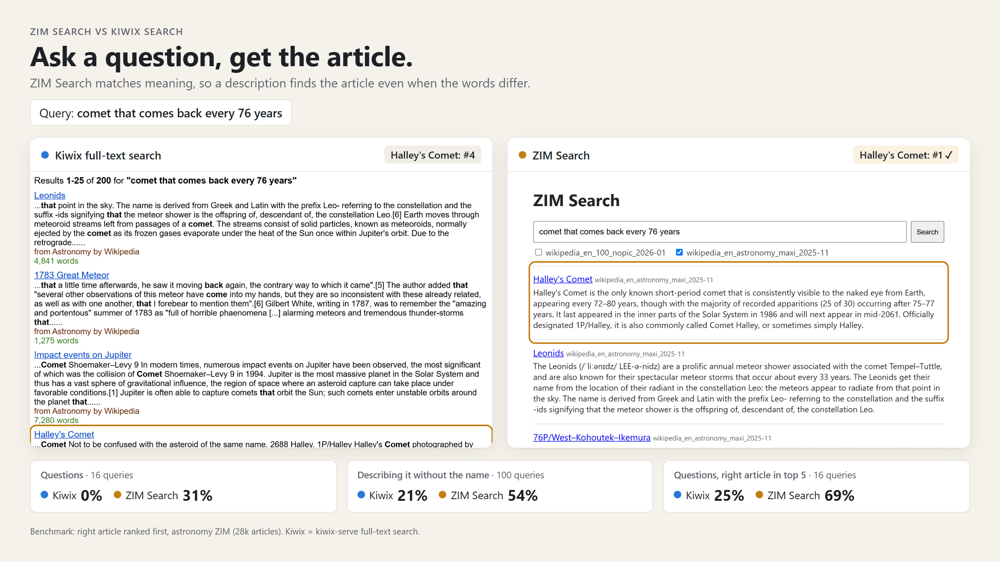
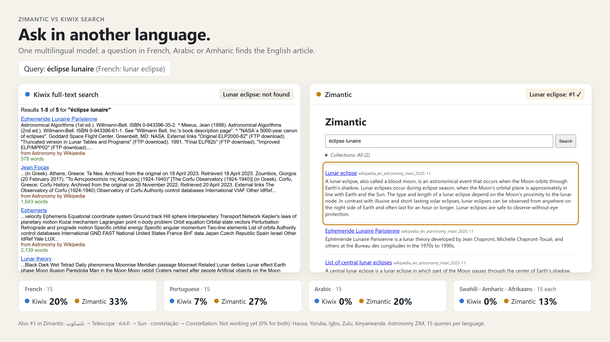
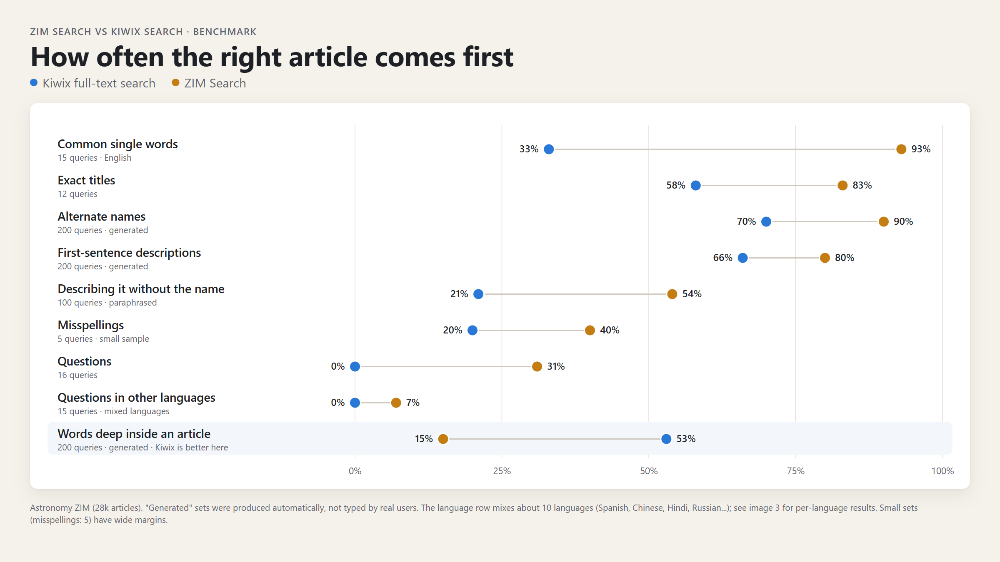

# Zimantic

**Offline search that understands what you mean for Kiwix ZIM files.**

Zimantic provides meaning-based search for ZIM files, the compressed offline copies of Wikipedia and
other sites published by Kiwix. Ask a question, describe something without knowing its name, misspell
it, or search in one of 100+ languages, and Zimantic finds the article closest to what you mean. It
works best in widely spoken languages. Everything runs offline, on hardware as small as a Raspberry Pi
Zero 2 W.

| You type | Kiwix search | Zimantic |
|---|---|---|
| "what causes lockjaw" | *Tetanus* not in the top 20 | *Tetanus* at **#1** |
| "diabetis" (misspelled) | *Diabetes* not in the top 20 | *Diabetes* at **#1** |
| "糖尿病" (Chinese for "diabetes") | *Diabetes* not in the top 20 | *Diabetes* at **#1** |

*Searched in WikiMed, the Wikipedia medical encyclopedia ZIM. Results below.*

## Features

- **Search by meaning**: questions and descriptions find articles even when they share no words with the title.
- **Alternate names and misspellings**: "diabetis" finds *Diabetes*; "Leber's disease" finds *Leber's hereditary optic neuropathy*.
- **Multilingual**: one model covers 100+ languages; a query in one language finds articles written in another. Strongest in widely used languages (see the results below).
- **Several sources at once**: search any combination of your ZIMs and rank the results together in one list.
- **Best of three searches**: meaning, title-word and full-text retrieval are fused into a single ranking.
- **Clean results and previews**: redirects are merged into their article, so each article appears once, with a bounded excerpt as its preview.
- **Progressive results**: sources run in parallel and the page shows a provisional merged list as each source finishes, then reranks it deterministically.
- **Source-aware UI**: discover sources, sort matching sources by count, select multiple source filters, and reset with **All Sources**; the top 10 sources are shown with an **Other** catch-all when needed. Every search covers **all** available sources; source filters control what is displayed, never what is searched.
- **Lightweight and offline**: runs on low-resource devices, such as a Raspberry Pi Zero 2 W (512 MB RAM), using roughly 250–325 MB while serving.
- **Degrades gracefully**: title-word and full-text search work as soon as an index exists; vectors are optional. A fast index and `serve --fast` skip the model and FAISS entirely.
- **Multi-user**: multiple searches can run at once (`max_concurrent_searches`); identical queries in flight share one computation, and repeated queries are answered from a small in-memory cache bounded by `cache_size` and `cache_bytes`.
- **Built-in article serving**: local result links open directly from the ZIM archives, including redirects, assets, and each ZIM's homepage, without requiring `kiwix-serve`.
- **Web page and JSON API**: search from any browser on the network or use your own programs.
  Routes use short paths such as `/search`, `/content/<zim>/<path>`, `/article/<zim>/<path>` and `/health`.

Zimantic can search and serve articles from its local ZIM archives. An optional
[kiwix-serve](https://kiwix.org/en/applications/) remains useful for sources that are only
available through a Kiwix server, but local indexed results do not require it.

### Measured memory use

As a reference point, a clean benchmark using the `wikipedia_en_100_2026-08.zim` ZIM (5,056
articles) and one local index measured these peak resident set sizes:

| Operation | Peak RSS |
|---|---:|
| Full index rebuild | 301.7 MiB |
| Semantic server (`serve`) | 323.5 MiB |
| Title and full-text server (`serve --fast`) | 65.6 MiB |

The server benchmark loaded the embedding model, opened the single ZIM index, and handled health,
source-discovery and search requests. `serve --fast` omits the model and FAISS, so it uses much less
memory but does not provide meaning-based search.

**Where the memory goes.** The ~118 MB int8 model and the SentencePiece vocabulary (~50 MB of
native memory) make up most of the footprint; they are loaded once and are not duplicated, and
`gc.collect()` cannot release them because they are C++ allocations, not Python objects. ONNX
Runtime also reads the file into a temporary buffer while loading (so there is a short-lived ~2×
peak at startup) and its **CPU memory arena** keeps the working set of the largest embedding batch
for the lifetime of the session. At `batch_size = 32` that arena alone can consume ~400 MB and
retain it. On hosts with **2 GB RAM or less**, Zimantic therefore disables the arena and returns
freed heap memory to the OS between batches (`malloc_trim` on glibc), capping build memory near the
model size at a modest throughput cost. Machines with more RAM keep the arena for faster builds.
`serve` embeds one query at a time, so the arena costs little there either way.

## How it works

### 1. Indexing a ZIM (`build`, once per ZIM)

**What gets read.** Every entry is visited once; images, stylesheets and scripts are skipped.
Redirects are stored as **title-only** entries pointing to their article, so searching "USA" still
finds the United States page.

**App-shell ZIMs.** Some ZIMs store article bodies in JSON or Markdown behind a JavaScript shell.
Zimantic reads that companion and keeps each article's own path as a deep link, so results point to
the real article instead of the shared shell. This covers Kiwix's `content/page_content_<id>.json`,
media/app bundles that keep a `<slug>.json` companion (for example `videos/<slug>.json` or
`playlists/<slug>.json`) keyed by the deep link, and docs/curriculum bundles (freeCodeCamp and
similar) whose `<route>.md` holds the body under `content/`. Plain-text fields such as video
descriptions and Markdown prose are indexed too (front matter and fenced code are dropped). Shell
stubs and "enable JavaScript" notices are skipped.

**Text extraction.** Stylesheets, scripts, footnotes, page chrome (category footers, navboxes,
tables of contents, maintenance tags) and common boilerplate are ignored, including page chrome that
is nested or hidden (`display:none`, `visibility:hidden`, the `hidden` attribute). When a page
repeats the same text under `lang-*` classes (parallel translations, as in TED talks), only the
`lang-default` copy is kept. Visible blocks are collected in priority order, with paragraphs
preferred, and block boundaries keep neighboring text runs from running together.

Each article's **excerpt** is extracted transiently for the embedding and discarded after the
vector is built. At search time, only the displayed local results are extracted again for previews,
bounded to `max_preview_chars` (1,000 by default) at a word boundary. Extraction reads up to 4 MiB
per page by default. The builder skips an entry only when its decompressed size exceeds
`max_entry_bytes` (1 GiB on desktop, 256 MiB on the mobile profile); this high safety ceiling
preserves large, friendly articles while preventing pathological entries from exhausting memory
before the parser limit can be applied.

**Other ZIMs** (Stack Exchange, Gutenberg, TED, …) are supported when they contain readable text:
HTML, XHTML, plain text and PDFs. PDF text is read from the file's embedded text layer, so scanned
documents without one are skipped.

**Embedding.** Titles and transient excerpts are embedded with
[multilingual-e5-small](https://huggingface.co/intfloat/multilingual-e5-small) (int8 ONNX, ~118 MB).
The model receives a fixed 256-token budget. Search previews are generated independently from
the local ZIM only for the final displayed page.

**Storage.** Each ZIM gets two files in `index_dir`:
- `<name>.sqlite`: titles, paths, redirect targets, and a full-text index of the titles (SQLite FTS5).
- `<name>.faiss`: the vectors, in one of two layouts depending on article count:

The index identity is `(ZIM filename stem, source byte size)`, not the source path. A ZIM can
move between nested folders below `zim_dir` without rebuilding. If one scan finds the same stem at
different sizes, those conflicting inputs are rejected with a warning.

| ZIM size | Vector index | Why |
|---|---|---|
| Under 10,000 articles | **Flat**: the query is compared with every vector | Exact, and small enough (a few MB) that comparing everything is fast |
| 10,000 articles or more | **IVF + 8-bit (SQ8)**: vectors are grouped into 4·√n clusters, and each search scans about 6% of the closest clusters by default (64 of 1,062 on WikiMed's 70k articles) | Comparing millions of vectors per search is too slow. On WikiMed (70k articles), scanning 64 of 1,062 clusters is within a few points of scanning every cluster, at less than half the search time (26 ms vs 66 ms). The probe count scales automatically for larger ZIMs; set `nprobe` in `config.toml` to use a fixed value instead. 8-bit numbers are nearly exact. **Heavier compression (e.g. PQ48) loses ~25% of the top hits.** |

IVF training samples are selected across the ZIM and scale with the number of clusters, with at least
39 samples per cluster as required by FAISS.

The `.faiss` file is memory-mapped, so searches read only the clusters they touch.

Builds resume from the last saved batch. FAISS files are published atomically, and a fast index
remains available while a full index builds. `build --force` applies the configured extraction and
excerpt settings and removes excerpts stored in existing indexes.

### 2. Starting the server

At startup Zimantic opens every **finished** index and keeps it open; nothing is reloaded per search.
FAISS and vector files load in the background during startup, so title-word and
full-text searches are available while semantic search initializes.
The page automatically lists local indexes. With `kiwix_server`, it also discovers catalog sources and
can search them with Kiwix full-text search. Kiwix catalog discovery is capped at 50,000 entries and
remote XML responses are capped at 64 MiB by default; both limits are configurable.

An index remains usable without FAISS: the server falls back to **title-word and ZIM full-text
search**. `serve --fast` also skips the model and all vectors.

FastAPI serves a lightweight HTML page that is accessible from any browser at
`http://<host>:8090` (the `port` in `config.toml`).

**Reloading indexes without a restart.** `zimantic reload` sends `SIGHUP` to a normal server,
which rescans `index_dir` and reconciles the available indexes. `kill -HUP <pid>` also works.
In `serve --debug` mode (also available as the `serve --dev` alias), SIGHUP restarts the
whole server process and reloads all in-memory state.

### 3. Each search

1. **Embed the query** with the same model used to index.
2. **Run three searches on each selected local source.** Sources run in parallel, up to
   `search_workers` at a time:

   | Search | Finds | Good at | Time |
   |---|---|---|---|
   | **Meaning** (FAISS) | Articles whose bounded content-excerpt vector is closest to the query (cosine similarity) | Questions, descriptions, other languages | ~13 ms |
   | **Title words** (SQLite FTS5, BM25 ranking) | Titles containing every word of the query, including redirect titles | Exact titles, alternate names (via redirect titles) | ~4 ms |
   | **Full text** (the ZIM's own Kiwix index) | Articles containing the words anywhere | Words buried deep inside an article | ~8 ms |

3. **Collapse redirects**: every redirect hit resolves to the article it points to, and duplicates are merged, so each article appears only once.
4. **Filter weak meaning matches.** Semantic candidates below `min_cosine_similarity` (0.85 by default) are discarded before ranking. Title-word and full-text matches still work below that floor, so the threshold only controls meaning-only results. Lower it in `config.toml` when a corpus needs broader semantic recall.
5. **Merge the three lists with Reciprocal Rank Fusion (RRF).** Their scores are not comparable: one is cosine similarity, another is a BM25 score, and the third is a position in Kiwix's list. RRF therefore ignores scores and uses positions only: an article earns `1 / (60 + its position)` from each list it appears in. An article found near the top by several searches beats one that's first in just one. Redirects are collapsed before fusion, so an article can contribute at most once per search list. A bounded lexical bonus favors titles containing more query words, with compact titles preferred when coverage is equal; exact phrases in titles or readable article text and configured source intent provide additional deterministic signals. Stack Exchange-style profile pages under `/users/` are demoted unless the query explicitly asks for a user or profile.
6. **Treat disambiguation pages specially.** At build time a page is flagged when its title ends in "(disambiguation)", it renders the "This disambiguation page" footer, or it carries a disambiguation category (the rendered `Category:` link or `wgCategories`). The required suffix is stored in the title, so no separate disambiguation metadata is needed. A query that names the full title is treated as navigation, whether it writes `air (disambiguation)` or `air disambiguation`; a question that names the base title and ends in `?` is treated as navigation too. Those queries promote the page above the normal score range. Any other query that merely matches it is demoted so the real article wins.

Search ranks one pool of results (up to `max_results`, at least `candidate_count`) and caches it by
query and source set. Paging and display filters reuse that pool.

The streaming endpoint sends a provisional page as each source finishes. Pagination uses regular links
and refreshes the page through the JSON endpoint without a full document reload.

*WikiMed timing: a complete search is 26 ms (median over 785 benchmark queries).
A Raspberry Pi Zero 2 W takes around 150 ms.*

## Compared with Kiwix search





*Measured on WikiMed, the Wikipedia medical encyclopedia ZIM (`wikipedia_en_medicine_maxi_2026-04`,
70,523 articles), compared with kiwix-serve's full-text search.*

### Results by type of search

**#1** = the right article is the first result. **Top 5** = it's somewhere in the first five.
"Not in top 20" = it didn't appear in the first 20 results.

| Type of search | Example query → article wanted | Kiwix | Zimantic | #1 Kiwix → Zimantic | Top 5 Kiwix → Zimantic | Queries |
|---|---|---|---|---|---|---|
| Common single words | "tuberculosis" → *Tuberculosis* | #3 | **#1** | 33% → **100%** | 93% → **100%** | 15 |
| Exact titles | "Malaria" → *Malaria* | #2 | **#1** | 72% → **100%** | 100% → 100% | 25 |
| Alternate names | "Leber's disease" → *Leber's hereditary optic neuropathy* | #2 | **#1** | 52% → **82%** | 70% → **99%** | 200¹ |
| Misspellings | "diabetis" → *Diabetes* | not in top 20 | **#1** | 0% → **60%** | 7% → **83%** | 30 |
| First-sentence descriptions | "(INN) is a non-steroidal anti-inflammatory drug (NSAID)." → *Ampiroxicam* | #5 | **#1** | 72% → **83%** | 82% → **92%** | 200¹ |
| Describing it without the name | "poor blood flow to part of the brain that kills brain cells" → *Stroke* | #17 | **#1** | 8% → **37%** | 37% → **78%** | 60 |
| Questions | "what causes lockjaw" → *Tetanus* | not in top 20 | **#1** | 12% → **45%** | 28% → **80%** | 40 |
| Questions & phrases in other languages² | "Herzinfarkt" (German: heart attack) → *Myocardial infarction* | not in top 20 | **#1** | 0% → **33%** | 0% → **53%** | 30 |
| Words deep inside an article | "When undergoing lymphadenopathy, these are described as feeling like a 'firm pea'." → *Facial lymph nodes* | **#1** | #2 | **68%** → 28% | **78%** → 76% | 200¹ |

¹ The first set is generated automatically from the articles, not typed by real users. The other sets use
hand-written queries; with 25–60 queries each, their numbers are accurate to roughly ±12–18 points.
² Spanish, French, German, Chinese, Hindi, Arabic, Russian, Japanese, Swahili and Portuguese, mixed.

### Single words in other languages

These tests search the English articles with one word in another language, using 15 common medical words per language
(malaria, diabetes, fever, cough, pregnancy, heart, blood, …). The test uses purpose-built
translations, so less common languages may contain mistakes.

| Language | Example query → article wanted | Kiwix | Zimantic | #1 Kiwix → Zimantic | Top 5 Kiwix → Zimantic |
|---|---|---|---|---|---|
| English | "tuberculosis" → *Tuberculosis* | #3 | **#1** | 33% → **100%** | 93% → **100%** |
| Spanish | "dolor de cabeza" → *Headache* | not in top 20 | **#1** | 13% → **60%** | 20% → **73%** |
| French | "tuberculose" → *Tuberculosis* | #15 | **#1** | 13% → **53%** | 27% → **60%** |
| Portuguese | "coração" → *Heart* | #4 | **#1** | 13% → **53%** | 40% → **80%** |
| Afrikaans | "bloed" → *Blood* | not in top 20 | **#1** | 7% → **33%** | 20% → **33%** |
| Arabic | "سعال" → *Cough* | not in top 20 | **#1** | 0% → **20%** | 0% → **33%** |
| Hindi | "मलेरिया" → *Malaria* | not in top 20 | **#1** | 0% → **20%** | 0% → **33%** |
| Amharic | "ልብ" → *Heart* | not in top 20 | **#1** | 0% → **13%** | 0% → **13%** |
| Somali | "madax xanuun" → *Headache* | not in top 20 | **#1** | 0% → **13%** | 0% → **13%** |
| Swahili, Igbo, Zulu, Kinyarwanda | e.g. "ikholera" (Zulu) → *Cholera* | not in top 20 | **#1** | 0% → **7%** | 0–7% → 7% |
| Hausa, Yoruba | | | | 0% → 0% | 0% → 0% |

**Where Kiwix is still better or cheaper:**
- **Words buried deep inside an article.** Kiwix indexes every word, so it performs better on deeper
  searches (68% first vs 28%; in the top 5 they're nearly tied, 78% vs 76%). Zimantic only indexes
  each article's title and bounded content excerpt.
- **No setup.** Kiwix search works as soon as a ZIM is available. Zimantic indexes each ZIM first.
- **Smaller footprint.** Zimantic stores a `.sqlite` and `.faiss` per ZIM and needs more RAM.

## Requirements

- Python 3.14 (libzim ships per-version wheels and the pinned release currently provides 3.14 only)
- 32-bit Linux platforms (such as armhf/armv7) are not supported because required native
  dependencies do not publish compatible wheels. On a Raspberry Pi Zero 2 W this means running 64-bit
  Raspberry Pi OS (aarch64) is required.
- About 120 MB for the embedding model, plus your ZIM files
- Wikipedia-style ZIM files (Zimantic relies on their predictable HTML structure to find useful content blocks)
- Local indexed results are served directly by Zimantic, so `kiwix-serve` is not required.
  To serve remote-only results through Kiwix, run `kiwix-serve` and uncomment `kiwix_url` in
  `config.toml`; it is disabled by default.

## Where your files go

The installed CLI is separate from runtime data. By default the data directory is
`~/.local/share/zimantic`, so `config.toml` and its relative paths use the defaults:

```
~/.local/share/zimantic/
├── config.toml          ← settings (paths below are its defaults)
├── model/               ← model_dir: model.onnx + sentencepiece.bpe.model   (you download)
├── zims/                ← zim_dir:   your .zim files                          (you download)
├── indexes/             ← index_dir: <name>.sqlite + <name>.faiss            (build output)
└── zimantic.pid         ← server PID (present while serving)
```

If your files are somewhere else (on a USB drive or another disk), point `zim_dir`, `model_dir` or
`index_dir` in `config.toml` at them instead.

## Install

1. **Get the code and enter the data directory.** `config.toml` is optional; missing values use
   hardware-based defaults.

   ```bash
   mkdir -p ~/.local/share
   git clone https://github.com/OscSanto/zimantic.git ~/.local/share/zimantic
   cd ~/.local/share/zimantic
   ```

2. **Install the CLI with uv.** This installs the locked runtime dependencies without the
   development tools, then exposes the executable at `~/.local/bin/zimantic`:

   ```bash
   uv sync --locked --no-dev --no-editable
   ln -sfn "$PWD/.venv/bin/zimantic" ~/.local/bin/zimantic
   ```

   For development, use `uv sync` and `. .venv/bin/activate` instead.

3. **Download the model into `model/`** using these file names:

   ```bash
   mkdir -p model
   curl -L -o model/model.onnx https://huggingface.co/Xenova/multilingual-e5-small/resolve/main/onnx/model_quantized.onnx
   curl -L -o model/sentencepiece.bpe.model https://huggingface.co/intfloat/multilingual-e5-small/resolve/main/sentencepiece.bpe.model
   ```

   Zimantic warns if either file differs from the documented checksum, but still runs.

4. **Put your ZIM files in `zims/`.** Download them from
   [library.kiwix.org](https://library.kiwix.org) or [download.kiwix.org/zim](https://download.kiwix.org/zim/).

5. **Check `config.toml`.** Point `zim_dir`, `model_dir` and `index_dir` at your folders if needed.
   Set `kiwix_server` and uncomment `kiwix_url` only if you also want remote Kiwix sources.

6. **Check the installation:**

   ```bash
   zimantic --help
   ```

   For a development runtime check, activate the `uv` environment and run
   `python -m pytest tests/test_runtime_api.py`; use `python -m pytest` for the full suite.

## Development install

For a development environment based on the checkout:

```bash
uv sync
. .venv/bin/activate              # Windows: .venv\Scripts\activate
```

`uv sync --no-dev` omits test tools. `pip install .` also works in a virtual environment.

## Use

```bash
zimantic build                        # index every .zim in zim_dir (the default)
zimantic -v build                     # show info-level logging
zimantic build -vv                    # show debug-level logging
zimantic build zims/x.zim             # index one file
zimantic build zims/a.zim zims/b.zim  # several files
zimantic build --workers 4            # build up to four independent ZIMs at once
zimantic build /media/usb             # every .zim in a folder
zimantic build zims/a.zim /media/usb  # mix files and folders
zimantic build --fast                 # quick title-word + full-text index (no vectors)
zimantic build --force zims/x.zim     # rebuild one already-indexed ZIM
zimantic serve                        # web page on http://<host>:8090 after a build
zimantic serve --fast                 # start without a model or vectors
zimantic serve --debug                # include ranking scores and explanations; restart on SIGHUP
zimantic serve --dev                  # alias for --debug
zimantic reload                       # ask a running server to rescan index_dir
```

`build` accepts files or folders; a folder means all its `*.zim` files, and no arguments uses `zim_dir`.
Existing ZIM indexes are skipped. Pass `--force` to rebuild selected indexes.
Logging defaults to warnings, except that `serve` uses info when stderr is a terminal;
repeat `--verbose`/`-v` for info and debug output.

**Fast indexes.** `build --fast` stores titles and paths without reading article bodies or running the
model. Title-word and ZIM full-text search work; a normal `build` creates the vector index.

Normal builds embed 32 articles at a time by default. Independent ZIMs can be read and built
concurrently with `--workers N` or the `build_workers` setting; when unset, the default scales with
CPU and RAM. Full builds use a bounded shared embedding pipeline: at most `embedding_workers`
model calls run at once, and each ZIM can have only a small number of batches waiting for embedding.
When unset, `embedding_workers` also accounts for `embed_threads` so the model is not
oversubscribed. Tune `batch_size`, `build_workers`, `embedding_workers` and `embed_threads` in
`config.toml` for different hardware. Do not run concurrent builds that target the same ZIM index
identity (filename stem and source byte size).

**Hardware profiles.** Without `config.toml`, Zimantic selects mobile, desktop or supercomputer
defaults from the machine's resources. Copy `config.pi-zero-2w.toml` or `config.pi-5.toml` to pin
settings.

As a rule of thumb, keep enough free disk space when building indexes: about **20% of total ZIM file size**.

**Automatic indexing with systemd.** Ready-to-copy user units in `deploy/` watch `zims/`, build
indexes and reload the server as ZIMs become available:

- `deploy/zimantic.service` — the server, with `Restart=always` and sandboxing. Copy it to
  `~/.config/systemd/user/`, then `systemctl --user enable --now zimantic`.
- `deploy/zimantic-indexing-fast.path` + `deploy/zimantic-indexing-fast.service` — watch `zims/` and run a fast build
  followed by `reload` as a ZIM becomes available.
- `deploy/zimantic-indexing.service` + `deploy/zimantic-indexing.timer` — run the full build
  (with meaning vectors) once a night.

The path-triggered fast build runs for each ZIM in `zims/`. The full build runs from 01:00–06:00
local time by default; set its `ExecCondition` and timer to select a different window. A shared `flock`
prevents overlapping builds.

Each unit has install instructions in its header. The units assume runtime data at the default XDG
data directory, `~/.local/share/zimantic`, and the CLI installed at `~/.local/bin/zimantic`.
Adjust `WorkingDirectory` and `ExecStart` if you use a custom `XDG_DATA_HOME` or install the CLI
elsewhere.

The units call the installed `~/.local/bin/zimantic` executable, while `WorkingDirectory` keeps
configuration, model files, ZIMs, indexes and `zimantic.pid` under the data directory. `reload`
does not need `config.toml`; it reads the server PID from `zimantic.pid` next to it by default, or
from the file passed with `--pid`. A stale PID file (left over after a crash or a
signal-triggered shutdown) is reported and ignored.

Watch `zims/`, not `indexes/`, because builds write to `indexes/`. If you copy finished indexes from
another machine, watch `indexes/` and run only `reload`.

A running `serve` discovers indexes with `zimantic reload`; a fast index remains
searchable while a full index builds.

JSON API examples:

- `GET /search?q=...&zim=<name>&limit=10&offset=0&source=<key>` returns one page of results.
  Totals are in `X-Total-Count`, `X-Has-More`, `X-Offset` and `X-Page-Size` headers.
- `GET /search/stream?q=...&limit=10&offset=0&source=<key>` returns newline-delimited progress
  events and result snapshots.
- `GET /content/<zim>/<path>` serves a toolbar shell for a local ZIM entry; `GET /content/<zim>`
  serves the resolved ZIM homepage. The shell keeps the navigation bar in the page and loads the
  article itself from an inner iframe pointed at `/article/<zim>/<path>`, so the toolbar stays
  visible even when the article is missing or fails. `GET /article/<zim>/<path>` serves the raw
  entry: redirects are followed, article links and assets resolve under the same route, and entries
  larger than `max_article_bytes` return `413`. `max_html_bytes` only limits HTML read during
  indexing; `max_article_bytes` limits the uncompressed response body because Zimantic reads each
  requested entry into memory, including binary assets. The toolbar shell also uses the viewed
  article's own `<title>` and declared icon for the browser tab title and favicon (falling back to the
  ZIM's source icon); when the shell is embedded in the modal, the outer page mirrors them and restores
  its own title and favicon when the modal closes. HTML articles include a small navigation bar
  with Close, Home, Random, Copy link and Search controls. Modal articles also expose
  icon-only navigation through visible search results and, for nested articles, the adjacent article
  links listed on the article's parent page. When a modal article opens another modal article,
  the preceding article can also provide the navigation context. Back navigation uses browser
  history when available, otherwise the Close control attempts to close the tab. `GET /random?zim=<name>`
  redirects to a random indexed article's shell. Links from an offline article to an external
  `http` or `https` site show an in-modal notice identifying the destination as online and offer
  to open it in a new tab, avoiding failures from sites that disallow iframe embedding.
- Start the server with `zimantic serve --debug` to include ranking scores and explanations in both
  search endpoints. Debug result objects additionally include a `ranking` breakdown with each
  semantic/title/full-text rank and contribution, title-match signals, intent and
  disambiguation adjustments. Stream snapshots and `done` events include compact search stats
  (candidate pool size, source progress, match-method counts, cache status and elapsed time);
  the non-streaming endpoint exposes the same stats in `X-Debug-Stats`, and the web UI renders
  them under **Stats for nerds**. Debug output is configured for the whole server; it is not a
  URL parameter.
  SIGHUP restarts the whole server in debug mode; `serve --dev` is an alias for this mode.
- `GET /sources`, `/config`, `/zims` and `/health` return source, configuration,
  local-index and health information. Source records include a `homepage` path when the local ZIM
  exposes one. Health is read-only and reports index/archive capabilities, entry counts, homepage
  resolution, embedding state, and cache statistics.

Reloading indexes is **not** an HTTP API: running servers rescan via `zimantic reload` or
`kill -HUP <pid>`.

Exact queries use small LRU caches controlled by `cache_size` and `cache_bytes` (32 MiB per cache by default).
The ranked pool is shared across pages and display filters, and invalidated when the set of searchable
sources differs. For large libraries, `search_workers` controls how many ZIM indexes are searched in
parallel. `max_stream_ranks` limits intermediate progress-ranking passes; the final result still
ranks every source, while a lower value reduces CPU use on small devices. The automatic profiles
use 8 workers and 16 intermediate passes on desktops, and 2 workers and 8 passes on low-memory
devices.
