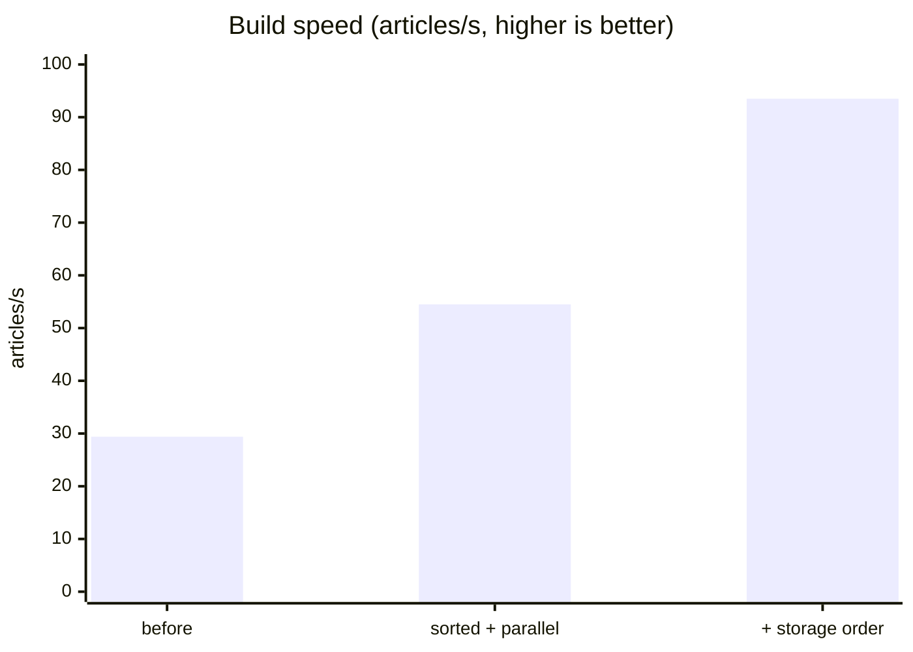
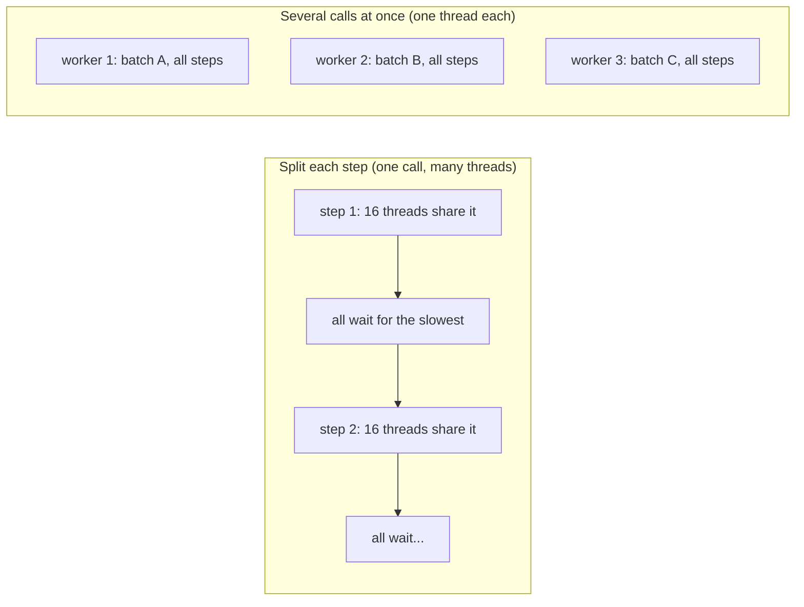
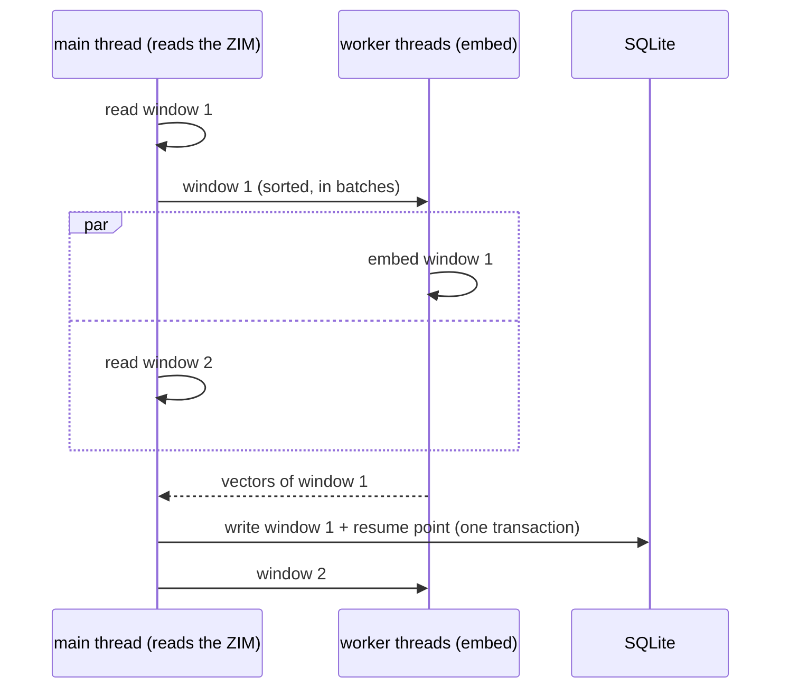

# Build speed: how index builds use the CPU

A build reads every entry of a ZIM file and turns each article's title and first paragraph into a vector
(multilingual-e5-small, ONNX, int8). This page explains what makes that slow or fast, what zimantic does about
it, and how to measure your own machine.

All numbers are from `wikipedia_en_top_nopic_2026-09`, a 40,000-entry slice (2,571 articles to embed), on a
Ryzen 7 8840HS laptop (8 cores / 16 threads, 16 GB), plugged in. Median of 2 runs.

## The short version

| Change | Why it helps | Build speed (articles/s) |
|---|---|---|
| Before | one batch at a time, every thread on it; reading and embedding take turns | 29.4 |
| Sort by length + several model calls at once + small batches + read while embedding | no padding waste, no threads waiting on each other, CPU never idle | 54.5 (1.9×) |
| + read the ZIM in storage order | each compressed cluster decompressed once | **93.5 (3.2×)** |



## 1. How the model uses the CPU

The model runs as about 300 steps in a fixed order (matrix multiplies, attention, normalization). A **batch**
is a group of texts run through those steps together, as one table of numbers.

There are two ways to use several cores:



- **Splitting each step**, ONNX Runtime's default: after each of the ~300 steps, every thread waits until the
  slowest one finishes. The more threads, the more waiting. It's worse with hyperthreads, where two threads
  share one core's math units, and when the OS pauses a thread for something else.
- **Several calls at once**: each worker thread runs a whole batch on its own and never waits for the others.
  All workers share **one** copy of the model, loaded once, because the model's weights are read-only. ONNX
  Runtime releases Python's lock (the GIL) while it runs, so the calls really run in parallel.

zimantic builds now use the second way: `embedding_workers` worker threads, each with `embed_threads: 1`.
Searches still use the first way, because there's one query at a time and it should finish as fast as possible.

## 2. Padding, and why sorting helps

The model needs every text in a batch to have the same number of tokens, so shorter texts are filled up with
padding to the length of the longest. The padding is computed and then thrown away.

| Batch | Token counts | Padded to | Computed | Wasted |
|---|---|---|---|---|
| Unsorted | 20, 30, 250 | 250 | 750 | 450 (60%) |
| Sorted | 20, 25, 30 | 30 | 90 | 15 (17%) |

Part of the model's cost (attention) grows with length², so long padded batches cost even more. A build now
reads a **window** of 512 articles, sorts it by length, and cuts it into batches. Sorting alone was **2.6×
faster** on full Wikipedia paragraphs, which vary more in length than first paragraphs.

## 3. Batch size

Big batches spread a call's fixed overhead (Python, tokenizing, starting and syncing threads) over more texts.
With one thread per call, that overhead is small, and small batches win instead:
- a window of 512 gives 64 batches of 8, so all worker threads stay busy until the window is done. Batches of
  32 give only 16, and some workers sit idle at the end;
- less working memory per call;
- less padding left after sorting.

| `batch_size` (sorted, 15 workers × 1 thread) | Articles/s |
|---|---|
| 32 | 65.3 |
| **8** | **93.5** |

## 4. Reading while embedding



The main thread reads the next window while the worker threads embed the current one. Each window is written in
one transaction together with the point to resume from, so a build stopped at any moment resumes cleanly.
This is why `embedding_workers: auto` is **hardware threads − 1**: the remaining thread reads.

## 5. Reading the ZIM in storage order

A ZIM stores articles in compressed **clusters**, blocks of several articles, in the order the file was
written. Entry ids follow article paths (alphabetical), which jump between clusters. libzim keeps recently
decompressed clusters in a small cache (zimantic sets 1 MB, to keep RAM low when serving). Reading in id order
therefore decompresses many clusters several times: 4,148 cluster switches for 2,284 clusters in the test
slice.

python-libzim can't list entries in storage order, so zimantic reads each entry's cluster number from the file's
own entry table ([ZIM format](https://wiki.openzim.org/wiki/ZIM_file_format)). That takes 0.3 s and 3.7 MB for
930,000 entries. Each cluster is then decompressed exactly once, and the disk is read front to back, which
helps SD cards and USB drives most.

| How the ZIM is read | Reading only (articles/s) | Extra RAM |
|---|---|---|
| id order, 1 MB cache | 133 | — |
| id order, 64 MB cache | 304 | +700 MB (libzim's cache uses ~11× the size it's set to) |
| **storage order, 1 MB cache** | **354** | **+4 MB** |

Old-style or damaged ZIMs fall back to id order.

## Does the index change?

The SQLite file (titles, first paragraphs, paths, redirects) is **identical**: the same 158,642 rows on the
Cooking Stack Exchange ZIM, and both files byte-for-byte identical on a small ZIM. Vectors change very slightly,
and search results barely move:

| Check (Cooking Stack Exchange, old build vs new build) | Result |
|---|---|
| Each text embedded alone vs in a batch, old batching (id order, 32) | mean cosine 0.99766 |
| Same, new batching (sorted, 8) | mean cosine 0.99775 |
| Same text embedded alone twice | 0.9999998 |
| Same top result, 200 queries | 100% |
| Top-10 overlap, 200 queries | 81% |

Why vectors move at all: the int8 model scales its numbers across the **whole batch** (dynamic quantization),
so a text's vector depends a little on which texts share its batch. That was already true before; the new
batching is as close to "each text alone" as the old one. The differences in the top 10 come from
near-ties being reordered, and from the vector index's groups being trained on slightly different vectors.
A full build of this ZIM took **698 s before and 241 s after (2.9×)**.

## 6. Hyperthreads and core counts

A physical core with hyperthreading runs two hardware threads, and both share the core's math units. Model math
keeps those units busy, so the second thread adds little:

| Worker threads (1 thread each) on 8 cores / 16 threads | Articles/s |
|---|---|
| 8 (one per core) | 80.7 |
| 15 (one per hardware thread, minus the reader) | 83.3 |

The build prints what it detected at start, for example
`AMD Ryzen 7 8840HS: 8 cores / 16 threads, 15.3 GB RAM (9.1 GB free), Windows AMD64`.

| Machine | `auto` workers | Notes |
|---|---|---|
| 8 cores / 16 threads PC | 15 | 8 would be about as fast with half the worker memory |
| Raspberry Pi 5 (4 cores, no hyperthreads) | 3 | on a 4-thread test, 23.9 → 44.8 articles/s (1.9×); a Pi CPU is slower in absolute terms |
| Raspberry Pi Zero 2 W (4 cores, 512 MB) | 3, **set 1–2** | RAM is the limit; large ZIMs are best built on a PC and copied over |
| 1–2 threads | 1 | still gets sorting, small batches, storage order and overlap |

## 7. Settings

| Setting | Default | Meaning |
|---|---|---|
| `batch_size` | 8 | articles with text per model call |
| `embedding_workers` | auto = hardware threads − 1 | model calls running at once while building |
| `embed_threads` | auto = 1 with several workers, else all cores | threads inside one model call |

## 8. Measure your machine

```
python scripts/bench_embed.py wikipedia_en_top_nopic_2026-09
```

It runs the real build loop on a slice of the ZIM, writes nothing, and prints one Markdown row: hardware,
settings, articles/s, peak RAM and the estimated embedding time for the whole ZIM. Flags (`--workers`,
`--threads`, `--batch`, `--order id`) try other settings. Please share rows from machines not listed yet.

## Things that made no difference

| Tried | Result |
|---|---|
| ONNX Runtime memory pool ("arena") on vs off | same speed. Off keeps about 600 MB less after a build |
| `allow_spinning = 0` (threads sleep instead of spinning while waiting) | no change with 1 thread per worker |
| Reading in a separate process (own GIL) | no faster than a reading thread |
| `MAX_TOKENS` 128 instead of 256 | ~1.05× faster; search quality not yet evaluated |
