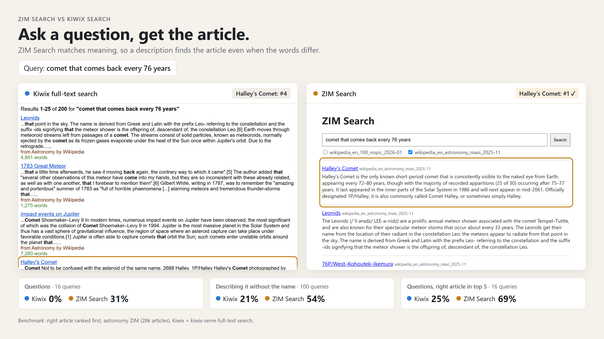
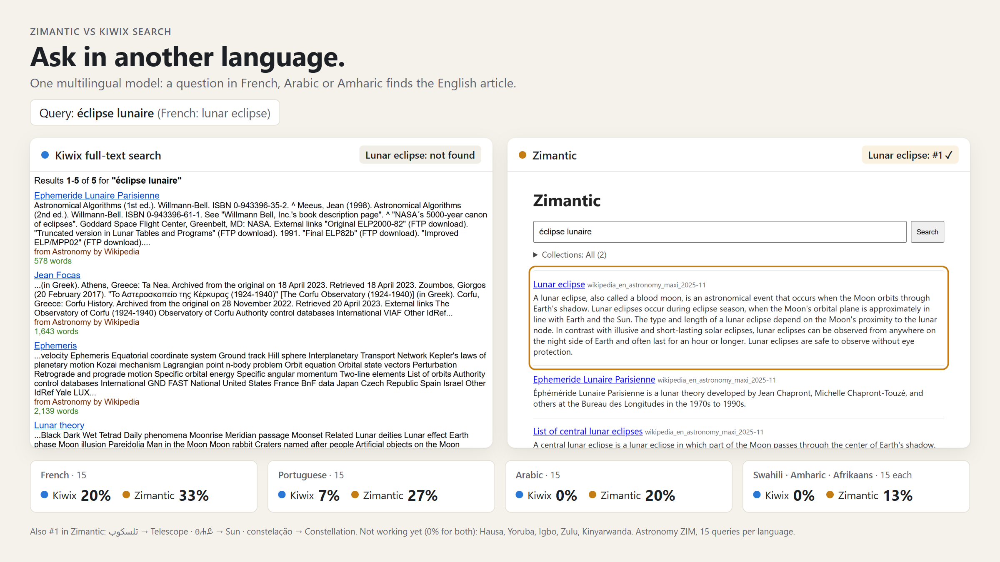
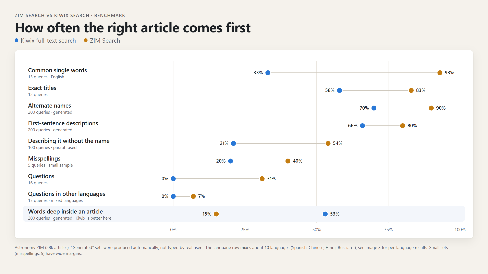

# Search, models, and ranking

## Using a different embedding model

The default is `multilingual-e5-small`, but Zimantic loads the ONNX graph and tokenizer vocabulary in `model_dir`. Two tokenizer formats are supported:

- `sentencepiece.bpe.model` selects the XLM-R SentencePiece tokenizer used by the multilingual-e5 models.
- `vocab.txt` selects the BERT WordPiece tokenizer used by the English e5-v2 models.

Zimantic selects the tokenizer from the vocabulary file. If the directory contains both files, it reads `tokenizer_config.json` when available. Otherwise, it selects SentencePiece. The ONNX graph does not identify its tokenizer. Apart from the vocabulary, the model follows the e5 contract: `input_ids` and `attention_mask` inputs (plus `token_type_ids` when the graph declares it), a `last_hidden_state` output, mean pooling, L2 normalization, and the `query: ` / `passage: ` prefixes.

`zimantic model` downloads the Xenova ONNX exports from a pinned revision and verifies each file's SHA-256 before replacing the destination. For the default model, fp32 is about 470 MB, fp16 about 235 MB, and int8 about 118 MB (the int8 export is Xenova's `model_quantized.onnx`). The default is int8, which is the smallest download and is optimized for CPU inference. **If you run embeddings on a GPU, prefer `zimantic model fp16`**: accelerated providers generally execute fp16 faster than quantized int8. Use fp32 only when comparing against a full-precision baseline. The probe check described below lets indexes built with one precision be served with another without re-embedding.

To try the larger multilingual model:

```bash
zimantic model int8 --model multilingual-e5-base
```

Replace `base` with `large` in the model name to try `multilingual-e5-large`. Non-default models get their own folder under the model root, so the base example writes `model/multilingual-e5-base/int8` (and does not replace the default model). For the English-only `e5-small-v2`, the command selects its WordPiece vocabulary automatically:

```bash
zimantic model int8 --model e5-small-v2 --dir model-e5-small-v2
```

The same command works for other BERT WordPiece e5-v2 models such as `e5-base-v2` and `e5-large-v2`; run `zimantic model --list` for the full set. Each precision goes into its own folder (`model-e5-small-v2/int8`, for example), so you can compare or switch without redownloading. Pass `--force` to replace an existing file whose checksum does not match.

Set `model_dir` directly to the folder containing `model.onnx` and its tokenizer
vocabulary (normally the selected precision folder). Zimantic does not search
parent directories for model files. Use a separate `index_dir` to keep the current
indexes available while you build indexes for the selected model:

```toml
model_dir = "./model-e5-small-v2/int8"
index_dir = "./indexes-e5-small-v2"
```

```bash
zimantic build --force
zimantic serve
```

Vectors are model-specific. Each full index records a fingerprint of `model.onnx` and the tokenizer vocabulary. A server configured with a different model ignores those vectors and serves title and full-text results until the index is rebuilt. Rebuild after switching models to restore semantic search. A checksum warning for a non-default model is informational.

A full build also stores a small set of fixed probe sentences and their embeddings. When the model fingerprint differs, `serve` re-embeds those stored probes with the configured model and reuses the index if the mean cosine similarity is at least 0.99 (and the minimum is at least 0.98). This lets an index built with the FP32 export be served with the int8 export of the same model, for example. It does not accept a different model or tokenizer, and indexes built before this feature have no probes, so they still require the same model file. The check is deliberately conservative: a different fine-tune with the same architecture should fail it.

These measurements use 256-token passages, batch size 32, and 4 CPU threads on one x86-64 host. Absolute numbers vary with CPU, but the ratios show the trade-off:

| Model | Int8 ONNX | Vector dim | Extra RSS¹ | Embedding² | Notes |
|---|---:|---:|---:|---:|---|
| `multilingual-e5-small` | 118 MB | 384 | ~190 MB | 68/s (1×) | Default; 100+ languages |
| `multilingual-e5-base` | 279 MB | 768 | ~340 MB | 26/s (0.38×) | 100+ languages; ~2.7× slower |
| `multilingual-e5-large` | 562 MB | 1,024 | ~730 MB | 9/s (0.13×) | 100+ languages; ~7.8× slower |
| `e5-small-v2` | 34 MB | 384 | ~65 MB | 64/s (0.93×) | English only; WordPiece |

¹ Additional resident memory for the model and vocabulary after loading, excluding ONNX Runtime's batch arena. Add this to the server's baseline footprint (see [Measured memory use](search.md#measured-memory-use)); leave about 0.5 GB of headroom for base and 1 GB for large. On hosts with 2 GB RAM or less the arena is disabled, so builds stay closer to these figures.

² Passages per second while embedding 256 passages in batches of 32. A single query embedding takes about 14 ms with either small model, 39 ms with base, and 110 ms with large, so query latency rises in the same direction.

`e5-small-v2` has the same 12-layer, 384-hidden encoder as `multilingual-e5-small`; the smaller file comes from a 30k-entry instead of a 250k-entry embedding table. It therefore saves roughly 125 MB of resident memory but embeds at about the same speed, and it cannot search non-English text. Choose it only for an English-only library on a RAM-constrained host; otherwise the default gives much broader coverage for the same compute.

Vector storage also grows with dimension: an 8-bit IVF index stores one byte per dimension per article (384 B, 768 B, and 1 KB), while a flat index for under 10,000 articles stores float32 vectors (1.5 KB, 3 KB, and 4 KB). FAISS flat indexes do not provide float16 storage; the SQLite staging table uses float16 during a build, but vectors are widened to float32 when written to FAISS. For a mostly English library on a small device, use the default. The base model is an option when cross-language recall matters; the large model needs more RAM.

## Measured memory use

As a reference point, a clean benchmark using `wikipedia_en_100_2026-08.zim` (5,056 articles) and one local index measured these peak resident set sizes:

| Operation | Peak RSS |
|---|---:|
| Full index rebuild | 301.7 MiB |
| Semantic server (`serve`) | 323.5 MiB |
| Title and full-text server (`serve --fast`) | 65.6 MiB |

The server benchmark loaded the embedding model, opened the single ZIM index, and handled health, source-discovery, and search requests. `serve --fast` omits the model and FAISS, so it uses much less memory but does not provide semantic search.

Where the memory goes. With the default model, the ~118 MB int8 weights and the SentencePiece vocabulary (~50 MB of native memory) make up most of the footprint; the English-only `e5-small-v2` replaces both with a ~34 MB model and a small WordPiece vocabulary. They are loaded once and are not duplicated, and `gc.collect()` cannot release them because they are C++ allocations, not Python objects. ONNX Runtime also reads the file into a temporary buffer while loading (so there is a short-lived ~2× peak at startup), and its **CPU memory arena** keeps the working set of the largest embedding batch for the lifetime of the session. At `batch_size = 32` that arena alone can consume ~400 MB and retain it. On hosts with **2 GB RAM or less**, Zimantic therefore disables the arena and returns freed heap memory to the OS between batches (`malloc_trim` on glibc), capping build memory near the model size at a modest throughput cost. Machines with more RAM keep the arena for faster builds. `serve` embeds one query per active search; up to `max_concurrent_searches` queries can be in flight, but each query is a single short sequence, so the arena costs little there either way.

## How it works

### 1. Indexing a ZIM (`build`, once per ZIM)

What gets read. Every entry is visited once; images, stylesheets, and scripts are skipped. Redirects are stored as **title-only** entries pointing to their article, so searching "USA" still finds the United States page.

App-shell ZIMs. Some ZIMs store article bodies in JSON or Markdown behind a JavaScript shell. Zimantic reads that companion and keeps each article's own path as a deep link, so results point to the real article instead of the shared shell. This covers Kiwix's `content/page_content_<id>.json`, media and app bundles that keep a `<slug>.json` companion (for example `videos/<slug>.json` or `playlists/<slug>.json`) keyed by the deep link, and docs/curriculum bundles (freeCodeCamp and similar) whose `<route>.md` holds the body under `content/`. Plain-text fields such as video descriptions and Markdown prose are indexed too (front matter and fenced code are dropped). Shell stubs and "enable JavaScript" notices are skipped.

Text extraction. Stylesheets, scripts, footnotes, common boilerplate, and page chrome (category footers, navboxes, tables of contents, maintenance tags) are ignored, including page chrome that is nested or hidden (`display:none`, `visibility:hidden`, the `hidden` attribute). When a page repeats the same text under `lang-*` classes (parallel translations, as in TED talks), only the `lang-default` copy is kept. Visible blocks are collected in priority order, with paragraphs preferred, and block boundaries keep neighboring text runs from running together.

Each article's **excerpt** is extracted transiently for the embedding and discarded after the vector is built. A separate lexical **body** is tokenized into the contentless FTS5 `body` table up to `max_body_text_bytes` (1 MiB per item by default), independently of the short `max_preview_chars` (1,000 by default) embedding/preview limit. Extraction stops at a UTF-8 character boundary; `body_truncated_count` reports how many rows were cut off by the budget or an incomplete native parse. At search time, only the displayed local results are extracted again for previews, bounded to `max_preview_chars` at a word boundary. Only the first `preview_limit` results of a page are hydrated (10 by default, matching the default page size; 0 disables previews); the rest keep an empty `lead`. Preview extraction reads at most 32 KiB of HTML per page, falling back to the `max_html_bytes` limit when that prefix has no readable text, so a few large pages do not hold up the whole result page. Entries are skipped when they are assets, JavaScript shells, empty pages, scanned PDFs without text, or other non-article content. Pages that ship only script or link references (for example PhET simulations) remain title-only, so they can still be found by title. The builder also skips an entry whose decompressed size exceeds `max_entry_bytes` (1 GiB on desktop, 256 MiB on the mobile profile); this high safety ceiling preserves large, useful articles while preventing pathological entries from exhausting memory before the parser limit can be applied. Companion JSON and Markdown bodies are subject to the same limit.

**Other ZIMs** (Stack Exchange, Gutenberg, TED, and others) are supported when they contain readable text: HTML, XHTML, plain text, and PDFs. PDF text is read from the file's embedded text layer, so scanned documents without one are skipped.

Embedding. Zimantic embeds titles and temporary excerpts with [multilingual-e5-small](https://huggingface.co/intfloat/multilingual-e5-small) (int8 ONNX, about 118 MB). The model uses a fixed budget of 256 tokens. See [Using a different embedding model](search.md#using-a-different-embedding-model) for other e5 models, their tokenizers, and their memory and speed costs. Entries without body text, such as JavaScript loader pages, remain searchable by title and full text but have no semantic vector. Zimantic creates previews from the local ZIM only for results on the displayed page.

Storage. Each ZIM gets an immutable generation under `index_dir/<provider>/<collection-slug>-<hash>/<source-slug>-<hash>/generations/<build-generation>/` (`index.sqlite`, optional `index.faiss`, and a `lease`), plus one shared catalog:

- `index.sqlite`: titles, paths, redirect targets, title postings, and a separate compact contentless FTS5 body index (`detail=none`, `columnsize=0`, `unicode61 remove_diacritics 2`). The `vecs` table exists in every generation but is empty once a full build writes `index.faiss`; a fast build leaves it empty too. Raw excerpts and raw derived text are not stored.
- `index.faiss`: the vectors (the only place finished embeddings are stored), in one of two layouts depending on article count. A fast or empty-semantic build has no `index.faiss`.
- `staging-fast.sqlite` / `staging-full.sqlite` (when present): resumable private staging files. They are not published generations and are removed after a successful build or a fatal failure.
- `catalog.sqlite` (beside `index_dir`, not inside it): a provider-neutral `sources` table keyed by canonical source key, with the metadata used by `/sources` and `/library.json` (title, description, language, creator, publisher, date, provider ID, category, normalized tags, item count, license, origin, attribution, relation, content-type counts, homepage, native full-text capability, and the icon as a BLOB). It stores the absolute archive path only as a private indexed locator, never as source identity. It contains metadata and icons only, never vectors. It is a disposable cache: the ZIM files are the source of truth, and deleting it makes the next scan rebuild it. A warm catalog lets `serve` list sources without opening every archive; the startup scan still opens each new, resized, or previously failing ZIM to refresh its row, and the first scan after deleting the catalog opens every archive. After that, archives and their libzim `Searcher` objects are opened lazily on first use. A missing or unreadable `zim_dir` (for example an unmounted USB drive) is an error that keeps the previous catalog, rather than being mistaken for a library from which every ZIM disappeared. While the directory is unavailable, the served `/sources` and `/library.json` lists are empty; the catalog rows remain on disk for the next successful scan once the directory is back. An unreadable subdirectory is logged as an error and its sources are omitted, but the rest of the library stays available.

The logical source key uses the provider, collection, and root-relative archive path, never an absolute filesystem path. Relocating a collection root without changing its relative layout preserves keys. Two archives can share a stem and size and still be distinct sources; each build writes an immutable generation and atomically replaces the `current` manifest. Build fingerprints use the archive UUID, size, and whole-second mtime as practical change detectors, not proof of identical bytes. A same-size write that restores the mtime can evade detection. Keep source content immutable or use an external snapshot when strong consistency matters. Indexes with stem-based paths are not served; build them with the current locator to restore indexed search. To copy a subset of finished indexes to another machine, see [Copying finished indexes to another machine](collections.md#copying-finished-indexes-to-another-machine).

Only the current index schema and canonical metadata are served or resumed.
`build` can reuse vectors from recognized v0 root-level pairs as described
above; other older indexes, including positional body indexes, are rebuilt.
Interrupted builds resume only within the current schema. Cross-model embedding
probes still allow vector reuse between compatible model exports.

| ZIM size | Vector index | Why |
|---|---|---|
| Under 10,000 embedded articles | **Flat**: the query is compared with every vector | Exact, and small enough (a few MB) that comparing everything is fast |
| 10,000 embedded articles or more | **IVF + 8-bit (SQ8)**: vectors are grouped into up to 4·√n clusters (capped so FAISS can train at least 39 points per centroid), and each search scans about 6% of the closest clusters by default (64 of 1,062 on WikiMed's 70k articles) | Comparing millions of vectors per search is too slow. On WikiMed (70k articles), scanning 64 of 1,062 clusters is within a few points of scanning every cluster, at less than half the search time (26 ms vs 66 ms). The probe count scales automatically for larger ZIMs; set `nprobe` in `config.toml` to use a fixed value instead. 8-bit numbers are nearly exact. **Heavier compression (for example PQ48) loses ~25% of the top hits.** |

IVF training samples are selected across the ZIM and scale with the number of clusters, with at least 39 samples per centroid as required by FAISS.

The `.faiss` file is memory-mapped, so searches read only the clusters they touch.

Builds resume from the last saved batch. FAISS files are published atomically, and a fast index remains available while a full index builds. Changing between `--fast` and a full build after an interruption restarts that index, because fast rows have no vectors to reuse. `build --force` applies the configured extraction and preview settings while rebuilding the selected indexes.

Use `--force` to rebuild a completed index when the ZIM has the same filename stem and byte size. Use it when you select a different embedding model or tokenizer, change text extraction or indexing behavior, replace a ZIM with different content of the same size, convert a full index to `--fast`, repair an index whose `.faiss` file is missing, or replace a suspect index. It is not needed when the ZIM size differs, when a build resumes, or when a full build follows a fast build. `--force` deletes the existing SQLite, FAISS, and upgrade files before rebuilding. Use a separate `index_dir` to preserve indexes for another model.

### 2. Starting the server

At startup Zimantic reads the shared `catalog.sqlite` for source metadata, homepages, counts, and icons. It resolves the `current` manifest of each **finished** index generation whose archive is present and matches the build-time source fingerprint. A cold catalog is refreshed synchronously. The scan opens each ZIM that is not in the catalog, whose fingerprint differs, or whose prior scan failed. The server opens other archives and their libzim `Searcher` objects on the first search or article request. Zimantic also discovers ZIM files in `zim_dir` without a usable SQLite index and uses each archive's native full-text index as a fallback.

The server ignores an index when its ZIM is missing. If the ZIM size does not match the index, the server uses the archive without that index. Run `build` to restore indexed search. A partial or stale index does not hide an available ZIM. For each source, a finished SQLite index takes precedence over the filesystem fallback; an unfinished index uses that fallback. FAISS vectors load in the background during startup, so title and full-text search work while semantic search initializes.

The page automatically lists sources from every configured collection. A Kiwix collection discovers catalog sources and searches them with Kiwix full-text search. Catalog discovery is paged and capped per entry at `max_catalog_entries` (default 50,000); remote XML responses are capped at `max_response_bytes` (default 64 MiB). An unscoped search uses at most each entry's `max_remote_sources` (default 100); selecting a remote source explicitly always searches it. Selecting a Kiwix collection explicitly schedules sources in catalog order up to the global `max_explicit_collection_sources` (default 500) and the request deadline, and reports any partial scope instead of claiming completion. Catalog refresh runs in the background: a failed refresh keeps the last complete catalog addressable, retries with bounded backoff, and reports the failure on the collection's discovery state. A failed source search is reported only in that request's result, so the next request can try again immediately.

Search without an index. `serve` works without a prior `build` and without `catalog.sqlite`. At startup, it scans configured ZIM collections and creates missing catalog metadata. A usable archive is a search source. An indexed ZIM without FAISS uses title and archive full-text search. A full index also provides SQLite body search. A ZIM without a SQLite index can use its native full-text index, but it has no SQLite title search, body search, or semantic search. Native full-text search can match titles, but it does not provide SQLite title ranking or its title bonus. If an unindexed ZIM has no native full-text index, it appears in `/library` but not `/sources` and is not searchable.

| What exists for a local ZIM | Semantic search (FAISS) | Title search (SQLite FTS5) | Body search (SQLite FTS5) | Archive full-text search (libzim) |
|---|:---:|:---:|:---:|:---:|
| Full index (`.sqlite` plus matching `.faiss`) | yes | yes | yes | yes |
| Fast index (`.sqlite` only) | no | yes | no | yes |
| No index, archive has a native full-text index | no | no | no | yes |
| No index, no native full-text index | no | no | no | no — library only, not searchable |

`serve --fast` skips the model and all vectors, leaving title and full-text search. A normal `serve` loads the model in the background; if `model_dir` is missing or unreadable it logs a warning and keeps serving lexical results. Vectors built with a different embedding model are ignored in the same way. For local sources, `kiwix-serve` is not involved: Zimantic searches the archive directly, and the archive's embedded full-text index is not a separate Kiwix index file. A Kiwix `[[collections]]` entry uses kiwix-serve's full-text API for remote sources.

FastAPI serves a lightweight HTML page that is accessible from any browser at `http://<host>:8090` (the `port` in `config.toml`). To serve it under a path such as `/zimantic`, set `web_base_path = "/zimantic"` and point a reverse proxy at the server with that prefix stripped:

```nginx
location /zimantic/ {
    proxy_pass http://127.0.0.1:8090/;
}
```

Generated links, assets, and API requests then stay under `/zimantic/`; open the page with the trailing slash.

Trusted vs. untrusted archives. By default the `/content/` shell is trusted and the article document inside it is **not** sandboxed. This keeps functionality intact, including persistent Web Storage and IndexedDB used by some offline sites. Set `secure_browsing = true` to sandbox the article document instead; the shell stays trusted, while the article runs with an opaque origin and gets the in-memory storage fallbacks described above. Secure browsing protects the app from untrusted source scripts, but it is not complete isolation from untrusted content: a raw `/article/...` URL opened directly is a top-level document and is still not sandboxed, and a popup opened by a sandboxed article with `allow-popups-to-escape-sandbox` likewise runs with the app's origin and persistent storage. Use the `/content/` shell for the bounded view, and treat direct `/article/` navigation and such popups as trusted. The setting remains off by default.

Content from every local provider is addressed as `/content/{source-key}/{path}` and `/article/{source-key}/{path}`. The source key is one percent-encoded path segment, so keys containing colons (for example `files:modules:root`) appear as `/content/files%3Amodules%3Aroot/...`. `/article` supports byte ranges (`Accept-Ranges: bytes`, `206`/`416`), including `bytes=0-` media playback, and advertises wildcard CORS for opaque-origin article frames and their preflights. Raw HTML receives the navigation bridge, so its response bytes can differ from the stored item; ranges are intentionally not applied to that decorated representation.

Reverse proxies must preserve the original request target rather than decoding or collapsing percent escapes. The server rejects encoded path separators (`%2F`/`%5C`) using the ASGI `raw_path` and fails closed for path-bearing content requests when a trustworthy raw target is unavailable. A proxy that normalizes the URI before forwarding it therefore disables path-bearing content serving even though the library and search pages still load.

Reloading indexes without a restart. `zimantic reload` sends `SIGHUP` to a normal server, which rescans `index_dir` and `catalog.sqlite` and reconciles the available indexes. `kill -HUP <pid>` also works. In `serve --debug` mode (also available as the `serve --dev` alias), `SIGHUP` restarts the whole server process and reloads all in-memory state.

### 3. Each search

1. **Embed the query** with the same model used to index.
2. Run three searches on each selected local source. Sources run in parallel, up to `search_workers` at a time:

   | Search | Finds | Good at | Time |
   |---|---|---|---|
   | **Semantic** (FAISS) | Articles whose bounded content-excerpt vector is closest to the query (cosine similarity) | Questions, descriptions, other languages | ~13 ms |
   | **Title search** (SQLite FTS5, BM25 ranking) | Titles containing every word of the query, including redirect titles | Exact titles, alternate names (via redirect titles) | ~4 ms |
   | **Full text** (SQLite body index and the archive's native index) | Articles that match either full-text source; the results are fused by rank | Words in the article body, including words deep in the archive | ~8 ms |

3. Collapse redirects. Every redirect hit resolves to the article it points to, and duplicates are merged, so each article appears only once.
4. Filter weak semantic matches when a lexical alternative exists. Semantic candidates below `min_cosine_similarity` (0.85 by default) are discarded before ranking only when the source also returns a title, body, or archive full-text match. If no lexical channel matches, Zimantic keeps the best semantic candidates. Lower the value in `config.toml` when a lexical match should not suppress broader semantic matches; cross-language queries often need 0.80 (see [Queries in another language](search.md#queries-in-another-language)).
5. Merge the three lists with Reciprocal Rank Fusion (RRF). The lists use different score scales: cosine similarity, BM25, and native full-text rank. RRF ignores scores and uses rank only: an article earns `1 / (60 + its position)` from each list it appears in. The full-text contribution is doubled for queries of ten or more words. An article that ranks near the top in several lists can beat one that ranks first in only one. Redirects are collapsed before fusion, so an article contributes at most once per list. A bounded lexical bonus favors titles that contain more query words, with shorter titles preferred when coverage is equal. Exact phrases in titles or readable article text and source-specific intent rules, such as WikiHow queries, provide additional signals. Stack Exchange-style profile pages under `/users/` rank lower unless the query asks for a user or profile.
6. Treat disambiguation pages specially. At build time a page is flagged when its title ends in "(disambiguation)", when it renders the "This disambiguation page" footer, or when it carries a disambiguation category (the rendered `Category:` link or `wgCategories`). The required suffix is stored in the title, so no separate disambiguation metadata is needed. Fast builds read a bounded HTML prefix for these signals; a footer that appears only beyond that prefix may need a full build to be detected. A query that names the full title is treated as navigation, whether it uses `air (disambiguation)` or `air disambiguation`; a question that names the base title and ends in `?` is treated as navigation too. Those queries promote the page above the normal score range. Any other query that merely matches it is demoted so the real article wins.

#### Queries in another language

A query in Chinese, Hindi, Arabic, or another language against an English ZIM often shares no words with its titles or article text. Semantic search can still retrieve the right article. Cross-language cosine scores are lower than same-language scores, even for correct results. The threshold applies only when a source also has a lexical match, so a query with no lexical match keeps its best semantic candidates at the default value of 0.85. A spurious lexical match can suppress them; a lower threshold can recover those results:

```toml
# config.toml
min_cosine_similarity = 0.80
```

This is a recall/precision trade-off, not a separate language mode. Lower values admit weaker semantic matches; they do not affect title, body, or archive full-text results.

Lexical search is tuned for mostly English text with space-delimited words. The stopword list includes English and Spanish. SQLite's `unicode61` tokenizer treats consecutive Chinese characters as one title token, and the long-query boost counts space-separated words. A long Chinese or Japanese query without spaces relies more on semantic search and its similarity threshold.

Search ranks one pool of results (the larger of `max_results` and `candidate_count`) and caches it by query, expanded source keys, and publication generation. Every explicit source or collection selection defines the whole scope directly; it is never promoted to a broader search, and an unknown selector is an error rather than an implicit full-library search. Paging reuses the cached pool. An explicitly selected Kiwix collection is bounded by `max_explicit_collection_sources` and the `search_timeout_seconds` deadline, and reports partial `scheduled`/`completed` counts instead of claiming completion.

The streaming endpoint sends a provisional page as each source finishes. Pagination uses regular links and refreshes the page through the JSON endpoint without a full document reload.

*WikiMed timing: a complete search is 26 ms (median over 785 benchmark queries). A Raspberry Pi Zero 2 W takes around 150 ms.*

## Compared with Kiwix search





*Measured on WikiMed, the Wikipedia medical encyclopedia ZIM (`wikipedia_en_medicine_maxi_2026-04`, 70,523 articles), compared with kiwix-serve's full-text search.*

The tables use three measures: **#1** means the target article is the first result, **Top 5** means it appears within the first five, and "not in top 20" means it does not appear in the first 20 results. Each percentage is the share of queries that met the measure.

### Results by type of search

| Type of search | Example query → target article | Kiwix | Zimantic | #1 Kiwix → Zimantic | Top 5 Kiwix → Zimantic | Queries |
|---|---|---|---|---|---|---|
| Common single words | "tuberculosis" → *Tuberculosis* | #3 | **#1** | 33% → **100%** | 93% → **100%** | 15 |
| Exact titles | "Malaria" → *Malaria* | #2 | **#1** | 72% → **100%** | 100% → 100% | 25 |
| Alternate names | "Leber's disease" → *Leber's hereditary optic neuropathy* | #2 | **#1** | 52% → **82%** | 70% → **99%** | 200¹ |
| Misspellings | "diabetis" → *Diabetes* | not in top 20 | **#1** | 0% → **60%** | 7% → **83%** | 30 |
| First-sentence descriptions | "(INN) is a non-steroidal anti-inflammatory drug (NSAID)." → *Ampiroxicam* | #5 | **#1** | 72% → **83%** | 82% → **92%** | 200¹ |
| Describing it without the name | "poor blood flow to part of the brain that kills brain cells" → *Stroke* | #17 | **#1** | 8% → **37%** | 37% → **78%** | 60 |
| Questions | "what causes lockjaw" → *Tetanus* | not in top 20 | **#1** | 12% → **45%** | 28% → **80%** | 40 |
| Questions and phrases in other languages² | "Herzinfarkt" (German: heart attack) → *Myocardial infarction* | not in top 20 | **#1** | 0% → **33%** | 0% → **53%** | 30 |
| Words deep inside an article | "When undergoing lymphadenopathy, these are described as feeling like a 'firm pea'." → *Facial lymph nodes* | **#1** | #2 | **68%** → 28% | **78%** → 76% | 200¹ |

¹ These 200-query sets are generated automatically from the articles, not typed by real users. The other sets use hand-written queries; with 25–60 queries each, their numbers are accurate to roughly ±12–18 percentage points.

² Spanish, French, German, Chinese, Hindi, Arabic, Russian, Japanese, Swahili, and Portuguese, mixed.

### Single words in other languages

These tests search the English articles with one word in another language, using 15 common medical words per language (malaria, diabetes, fever, cough, pregnancy, heart, blood, and so on). The test uses purpose-built translations, so less common languages may contain mistakes.

| Language | Example query → article wanted | Kiwix | Zimantic | #1 Kiwix → Zimantic | Top 5 Kiwix → Zimantic |
|---|---|---|---|---|---|
| English | "tuberculosis" → *Tuberculosis* | #3 | **#1** | 33% → **100%** | 93% → **100%** |
| Spanish | "dolor de cabeza" → *Headache* | not in top 20 | **#1** | 13% → **60%** | 20% → **73%** |
| French | "tuberculose" → *Tuberculosis* | #15 | **#1** | 13% → **53%** | 27% → **60%** |
| Portuguese | "coração" → *Heart* | #4 | **#1** | 13% → **53%** | 40% → **80%** |
| Afrikaans | "bloed" → *Blood* | not in top 20 | **#1** | 7% → **33%** | 20% → **33%** |
| Arabic | "سعال" → *Cough* | not in top 20 | **#1** | 0% → **20%** | 0% → **33%** |
| Hindi | "मलेरिया" → *Malaria* | not in top 20 | **#1** | 0% → **20%** | 0% → **33%** |
| Amharic | "ልብ" → *Heart* | not in top 20 | **#1** | 0% → **13%** | 0% → **13%** |
| Somali | "madax xanuun" → *Headache* | not in top 20 | **#1** | 0% → **13%** | 0% → **13%** |
| Swahili, Igbo, Zulu, Kinyarwanda | e.g. "ikholera" (Zulu) → *Cholera* | not in top 20 | **#1** | 0% → **7%** | 0–7% → 7% |
| Hausa, Yoruba | | | | 0% → 0% | 0% → 0% |

### Where Kiwix performs better

- Words buried deep inside an article. Kiwix indexes every word, so it performs better on deeper searches (68% first vs 28%; in the top 5 they are nearly tied, 78% vs 76%). Zimantic indexes only each article's title and bounded content excerpt.
- No setup. Kiwix search works as soon as a ZIM is available. Zimantic indexes each ZIM first.
- Smaller footprint. Zimantic stores a `.sqlite` and `.faiss` per ZIM and needs more RAM.
